# Emcomm-CNC

*Emcomm command and control.*

Turns a fresh minimal Debian 13 install into a dedicated emcomm station: it boots
straight into a full-screen touch launcher for the radio apps, with no desktop
environment. To try it on a Debian or Ubuntu computer you already use, see
[desktop mode](#try-it-on-a-computer-you-already-use-desktop-mode).

**Operating the station:** see the [operations guide](docs/operations-guide.md):
a cold start for first-time operators, every app's rig and audio settings, which
apps go together and in what order, and ARES/RACES walkthroughs. On the station,
the **Guide** tile shows it, with a **Print** button for the go-kit.

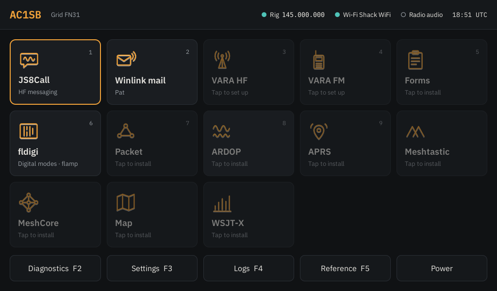

## What's in it so far

- **Base system:** a `radio` user, SSH for remote troubleshooting, PipeWire audio.
- **Firewall and security updates:** nothing on the network can reach the
  station except SSH and replies to connections it made itself, so no one on
  the same Wi-Fi can use the packet, ARDOP or VARA modems to key the radio.
  Outgoing traffic isn't limited. Debian's security updates install by
  themselves once a day, along with Debian's stable bug fixes (never new
  versions, and no restarts: a kernel update takes effect at the next restart).
  To let more in, list ports in `security_allow_tcp` or
  `security_allow_udp` in `host_vars`. A desktop install leaves the computer's
  own firewall and update settings alone.
- **Settings screen:** a page of large tiles: User (callsign, grid and time zone), Radio,
  Devices (GPS, and what's plugged in), Display, Wi-Fi, Accounts,
  Backup, Update station, Audio (the radio's sound card, and in desktop mode when
  it's the computer's default), Power and Home tiles (Settings and Diagnostics are in
  the top bar's ⏻ menu, and F3 and F2). User opens
  automatically on first boot. The time zone (Settings > User) sets the local time
  shown next to UTC in the top bar; while the computer is on UTC, only UTC shows
  (in desktop mode the computer's own time zone is used). Any radio Hamlib supports can be picked by
  manufacturer and model; the CAT port, PTT port and sound card are picked from the
  USB devices that are plugged in, with a Rescan button. Saving gives those devices
  stable names (`/dev/rig-cat`, `/dev/rig-ptt`, ALSA card `rigaudio`) and restarts
  Hamlib's `rigctld`, which every app uses to reach the radio on `127.0.0.1:4532`.
  `rigctld` starts by itself whenever the radio is plugged in.
- **GPS time and position:** plug in a USB GPS (any u-blox puck works with no
  setup; for another kind, pick its port under **GPS** in Settings). gpsd reads it
  and chrony sets the clock from it, so FT8, JS8Call and the logs keep the right
  time with no internet. The top bar shows the GPS grid square; when it differs from
  the saved one it says "tap to use", and tapping it (or **From GPS** next to the
  grid in Settings) fills in the new grid, ready to save. Diagnostics shows the
  fix and whether the clock is following the GPS.
- **Presets** (`radios/`): Yaesu FT-891 with a Digirig, and Yaesu FT-710. Optional
  shortcuts that fill in every radio field at once, even before the radio is plugged in.
- **Kiosk:** auto-login on the console, X with Openbox only, screen blanking off.
  The station starts with a start-up screen instead of scrolling text and goes
  straight to the launcher (the GRUB menu still shows briefly, for recovery
  mode). **Settings > Display > Start-up screen** picks it: the Emcomm-CNC logo
  with your callsign (the standard one), a picture of your own (PNG or JPG, from
  a USB stick or Downloads, filling the screen), a plain spinner, or the
  start-up messages as text. A change takes about a minute to save and shows at
  the next start; a new callsign shows after the next Update station. Apps
  open maximized under a thin **Home bar** across the top of the screen: **⌂ Home**
  brings the launcher back, each open app has a button to bring it to the front
  (and ✕ to close it), and the bar shows the callsign, local time and UTC. Tapping the
  tile of an app that's already open brings it to the front instead of starting a
  second copy. A tile flashes when tapped; while an app starts, its tile shows a
  spinner and **Opening…** until the window appears (more taps are ignored
  meanwhile), or **Didn't start** / **No window yet** after 45 s. There are no
  tap sounds, since the radio's sound card is the default output. With a
  keyboard, Alt+Tab also switches apps.
- **Several apps at once:** every app reaches the radio's sound card through
  PipeWire, so they can all listen together (JS8Call and the recorder, say).
  Transmit from one app at a time: there's one radio, and each app keys it and
  sets its frequency through the same rig control.
- **On-screen keyboard:** ⌨ in the launcher's top bar or **Keyboard** on the Home
  bar shows or hides Onboard, docked along the bottom of the screen. Tapping a text
  box in the launcher on a touchscreen brings it up by itself, and it goes away
  when you're done typing.
- **Launcher:** the home screen above. Works by touch, mouse or keyboard: Tab moves
  between buttons, 1–9 open tiles, Esc/F1 goes Home, F2 Diagnostics, F3 Settings,
  F4 Logs, F5 Reference, F6 Wi-Fi, F7 Online, F8 Net control, F9 Forms.
  Every drop-down list (radio make and model, ports, counties, logs...) can be
  searched: tap it and type in the box at the top, or with a keyboard just start
  typing on it; only the choices with every word typed stay, and Enter picks the
  first. A tile for an app that isn't installed says "tap to install". To use
  your own picture on a tile, long-press it (or right-click, or press the Menu key)
  and pick an SVG, PNG or JPG from a USB stick or `~/Downloads`; "Use the standard
  icon" puts it back. **Rename** in the same menu gives a tile (or a folder) your own
  name, and "Use the standard name" undoes it; names are kept in
  `~/.config/emcomm/tile-names.json`. To put the tiles in your own order, pick **Arrange tiles** from
  that same menu (or **Home tiles** in Settings), tap a tile, then tap where it
  should go; **Add a gap** leaves an empty space to group tiles into rows, and
  **Standard order** puts them back. Home holds 18 tiles a page (six across,
  three down) and tiles stay that size: with more apps, or after **New page**,
  swipe sideways, tap ◀ ▶ under the tiles or press Page Up/Down to change page.
  While arranging, pick a tile, go to another page and tap a tile or an empty
  place to move it there; **Remove page** folds the page shown into the one
  before it. Folders hold related apps under one tile: **Email** (Winlink mail,
  VARA HF, VARA FM) and **Mesh & APRS** (Meshtastic, MeshCore, Mesh text, MC text, APRS) come as
  standard. Tap a folder to open it; Esc or ‹ Home closes it. The quickest way
  to file an app is its long-press (or right-click) menu: **Move to a folder**
  lists the folders and **New folder…**, and an app in a folder has **Take it
  out**. While arranging,
  tap an app then a folder to put it in, **New folder** makes one (holding the
  app picked, if any), and a picked folder can be opened (to reorder or **Take
  out of folder** what's inside), renamed or removed (its apps go back on Home
  where it was). The order, pages and folders are kept in
  `~/.config/emcomm/tiles.json` (and in USB backups), and the 1–9 keys open the
  first nine tiles of the page or folder shown. **Display** in Settings sets the colours (Amber dark, Light,
  Slate blue, Night red, which keeps everything red to spare night vision, or
  Sunlight, the highest contrast for a screen outdoors), the screen resolution (Automatic picks the screen's own), the text
  size (Normal, Large or Extra large, for bigger screens; other apps follow it
  too) and the rotation, for a screen mounted on its side or upside down. A
  touchscreen turns with the screen. A change to the screen goes back by itself
  after 15 seconds unless you tap **Keep**, so a setting the screen can't show
  can't lock you out.
- **Radio apps:** JS8Call, WSJT-X, fldigi with flamp, QSSTV for pictures (SSTV), flmsg (ICS-213 forms; set to date and time everything in UTC, e.g. 1356Z), Pat for
  Winlink mail, VARA HF and VARA FM (under Wine), ARDOP (ardopcf), Direwolf for
  packet, Xastir for APRS, the Meshtastic (`contact`) and MeshCore
  (`meshcore-cli`) clients for LoRa mesh radios, Meshtastic's own desktop app
  and Meshy for MeshCore (Flatpaks from Flathub, installed from their tiles),
  and CHIRP for programming
  handhelds and mobiles. Every app reaches the radio through `rigctld`, so CAT and PTT are set up
  once, in Settings. Callsign and grid are filled in for each app.
- **Library** (tile): offline books from Kiwix, readable with no internet. With
  internet, tap **Download** next to a suggested book: WikEM (emergency medicine),
  post-disaster and water guides, Wikipedia's medical articles, Amateur Radio
  Stack Exchange and iFixit repair guides. Books are saved in `~/Library`. Any
  Kiwix `.zim` file on a plugged-in USB stick shows up too and is read straight
  from the stick, which is the way to carry big ones such as all of Wikipedia
  (get them from library.kiwix.org on another computer). **Open library** shows
  every book in a window with search.
- **Logs** (tile, F4): JS8Call messages and activity, WSJT-X contacts and Winlink mail in one
  place, plus a box to note a voice or other contact. Notes get the UTC time,
  frequency and mode from the radio. **Forms** on this page goes to the messages,
  nets and ICS forms.
- **Forms** (tile, F9): one page for everything written down during an event.
  The list on the left holds every ICS-213 message (the ones you wrote and the
  ones fldigi received), every net, and every ICS-309 log and ICS-205 plan
  filled in, newest first; a drop-down narrows it to one kind. Pick one to see
  it on the right: a message on FEMA's own General Message form (ICS 213), the
  same layout as the paper form; a net as its log. **New ▾** starts any of them:
  - **ICS-213 message** opens the blank form with a box on each field (To, From,
    Subject, Date, Time, Message, Approved by, Reply...), so the message is typed
    where it goes on paper; the date and time (UTC) are filled in, and the
    incident too while a net is open. **Reply / Edit** on a message in the list
    opens it the same way: a received message gets the reply boxes at the bottom
    and is saved as a copy, so what came in stays as it was.
  - **Net log** opens Net control (also F8): name the net and tap **Start net**.
    Type each callsign and press Enter to check it in, or fill in From, To and
    Message and tap **Log** for traffic; every entry gets the UTC time, and
    **Undo** removes the last one. Nets are kept in `~/.local/share/emcomm/nets`.
    As a callsign is typed, the line above it shows the name, town and licence
    class from the FCC's licence list kept on the station (no internet needed),
    flags an expired licence in red, and says when a US call isn't in the list
    (often a miscopied call). A check-in is logged with that name and town, and
    they print on the ICS-309. Contact notes on the Logs page do the same.
    Update station downloads the list (about 150 MB, kept only while it builds)
    when it's over a week old and the station is online; offline, the last list
    is kept. Calls outside the US aren't in it.
  - **ICS-309 Communications Log** fills in the log for the net picked in the
    list (else the open or last net), and **ICS-205 Radio Communications Plan**
    fills in the plan from My frequencies (receive and transmit frequency, tone,
    and the note as the assignment). Both are saved in `~/ICS forms` and open
    with a **Print** button; the print dialog can also save a PDF to a USB stick.
    An open net stays at the top of the list; its row has **Net control** and
    **ICS-309 log** buttons.

  **Send by radio** sends the message picked (or the one being written,
  saving it first) the way flmsg's AutoSend does, without opening flmsg: it
  shows whether fldigi is running (with a **Start fldigi** button if not), lets
  you pick the modem (MT63-2000L and the other NBEMS modems fldigi has; the one
  fldigi is on is picked), then puts the wrapped message in fldigi's transmit
  buffer, which keys the radio, and says when fldigi is back on receive. The
  other station's fldigi saves it for flmsg as usual. A copy of what went out is
  kept in `~/.nbems/WRAP/send`, and flmsg's `auto_sent.csv` gets a line, as if
  flmsg had sent it. **Save** keeps a message in flmsg's messages folder,
  and under **More ▾**, **Print** prints the form (or saves a PDF, which also
  lands in `~/ICS forms`) and **Open in flmsg** opens a message in flmsg itself,
  for its other forms.
- **Recorder** (the **Rec** button at the top of the screen, or on the Logs page):
  records the radio's receive audio to `~/Recordings`, each file named with the
  UTC time, frequency and mode. **Record when there's a signal** keeps only the
  parts with audio, so a frequency can be monitored for hours; **Record
  everything** records continuously in hourly files. Recording starts when you
  tap one of those and runs until **Stop**; turn on **Start recording when the
  station starts** to have it come back on by itself after a restart or power
  cut. **Rec** turns red while it records, in the launcher's top bar and in the
  Home bar above every app. Recordings play on headphones or a speaker, never
  through the radio, so they can't key it by VOX. To delete several at once, tap
  **Select**, tap the recordings (or **Select all**), then **Delete**.
- **Broadcastify** (on the Recorder page): streams the same receive audio to a
  Broadcastify feed. Apply for a feed at broadcastify.com; once it's approved,
  type its server, port, mount and password into **Feed settings** and tap **Go
  live**. It sends MP3 at 16 kbit/s mono as Broadcastify asks, reconnects by
  itself if the internet drops, and **At start-up** brings it back after a
  restart. **Live** shows next to **Rec** while it streams. The password stays
  in `~/.config/emcomm/broadcastify.json`, readable only by the station user.
- **Reference** (tile, F5): the US band plan with a which-band-when guide, emergency and
  calling frequencies (IARU emergency centres of activity, Hurricane Watch Net,
  SATERN, 60 m channels, simplex calling, APRS), JS8Call and FT8 dial
  frequencies, and other services to listen to (NOAA Weather Radio, marine
  channel 16, aviation guard, FRS/GMRS, MURS, CB 9 and 19; marked receive only).
  A line at the top says whether it's day or night at your grid and which HF
  bands to try nearby and far, with the Online page's band conditions when it
  has them. The row the radio is on is highlighted. A search box narrows any
  list by name, note, mode or MHz, and a drop-down by band. **Tune** puts the
  radio on that frequency and mode (and turns off any repeater offset or tone an
  earlier Tune set). **Save to mine** on any row copies it to **My frequencies**;
  **Add frequency** saves the radio's current frequency (or one you type) there
  with a name and note, for local nets and repeaters, and **Edit** on one of your
  rows changes or removes it. For a repeater, also give its offset (for example
  -0.6, or +5 on 70 cm) and CTCSS tone; **Tune** then sets the radio to FM with
  that offset and tone, on radios and bands that support it. **Load a list** adds
  a CSV from a USB stick or Downloads to My frequencies: the station's own layout,
  CHIRP's export, or a RepeaterBook or RadioReference download (it reads whichever
  frequency, name, offset, tone and mode columns the file has, and skips rows
  already there). The lists are CSV files (`MHz,Mode,Name,Note,Offset,Tone`;
  Offset and Tone may be left out) in `/usr/share/emcomm/reference`; a file of
  the same name in `~/.local/share/emcomm/reference` replaces the standard one.
  My frequencies is `~/.local/share/emcomm/reference/My frequencies.csv`.
- **Nearest Winlink gateways** (on the Reference page): every gateway channel from
  Pat's list, nearest to your grid first, with distance, bearing, mode and hours,
  and whether it's open now.
  Pick VARA HF, ARDOP, VARA FM or Packet to narrow it, and **Tune** puts the radio
  on the gateway's dial frequency (centre minus 1.5 kHz on HF, as Pat does). It
  works offline from Pat's saved list; **Update list** downloads a fresh one when
  the station has internet. The nearest HF gateway isn't always the easiest to
  reach: within about 300 miles, NVIS on 80 m or 40 m (or 60 m) works best.
- **Map** (tile): an offline map (countries, states, US counties, highways and
  cities from Natural Earth, and every US town, village and New England town from
  the Census Bureau's gazetteer, shown as you zoom in) with Maidenhead grid
  squares, your station, every Winlink
  gateway (blue HF, green VHF/UHF; tap one for its dial frequencies, modes and
  hours) and stations heard on JS8Call and WSJT-X with their grids. The gateway
  list is Pat's: it works offline from the copy built into Pat, and is refreshed
  when it's over a week old and the station is online. It also shows the stations
  that heard you (purple, with a line to each), as the Online page last saved them.
  **Aircraft** shows planes heard on ADS-B (1090 MHz), live and with no internet:
  callsign, altitude, speed and heading, moving every 2 seconds, red for an
  emergency squawk (7500, 7600, 7700). It needs an RTL-SDR dongle kept for it
  with a 1090 MHz antenna (a quarter-wave is about 6.9 cm; a FlightAware
  antenna and filter does better): pick it in **Settings > Devices > ADS-B
  receiver**. A dongle with its own serial number is remembered by it; cheap
  dongles often share 00000001, so the one picked gets serial 00001090 written
  into it and needs unplugging and plugging back in once (a FlightAware Pro
  Stick ships with 00001090 and is used without asking). The Scanner, Gqrx
  and weather alerts then use the other dongles. The decoder is
  dump1090-mutability with no network ports open.
  **Warnings** shades the areas under NWS watches, warnings and advisories for
  your state and its neighbours (red extreme, orange severe, yellow moderate,
  blue minor; tap one for what it is and when it ends). They're fetched when the
  station is online, at most every 10 minutes, and kept offline until each one
  ends. **Mesh** shows the Meshtastic (teal) and MeshCore (magenta) nodes that
  have sent a position, as the radio the Mesh text or MC text tile last
  connected to (USB or Bluetooth) knows them: tap one for when it was heard,
  SNR, hops and battery. The radio is asked when the map opens, with no
  internet needed; while its tile is open the last list stays.
  The buttons at the top right switch the background: **Map** is the built-in
  one; **Streets**, **Satellite** (aerial photos with roads and place names) and
  **Topo** are Esri's online maps, so they need the internet. The choice is kept.
- **Online** (the Online tile on Home, or F7): data from internet services, saved
  so the last answer still shows offline. Each section says when it was last updated.
  - **Weather alerts** for your grid from the National Weather Service (US only),
    most severe first; **Details** shows the full text. Alerts in force also show in
    the top bar; tap there to read them. Checked every ten minutes when online.
  - **Propagation:** solar flux, K index and the NOAA R/S/G scales from NOAA's Space
    Weather Prediction Center, and day/night HF band conditions from N0NBH
    (hamqsl.com), with a line on what the numbers mean.
  - **Who heard me:** stations that reported your signal to PSKReporter in the last
    six hours, with distance, band, mode and SNR. Transmit FT8, JS8 or another
    digital mode first; reports come from stations that are online.
  - **Callsign lookup:** name, address, grid, distance and licence from QRZ (or
    HamQTH if there's no QRZ login), plus the last APRS position from aprs.fi.
    Callsigns looked up before still show offline.
  - **Accounts:** QRZ and HamQTH logins, a contact email (sent to NOAA and
    PSKReporter so they know who's asking) and the aprs.fi API key. They're saved in
    `~/.config/emcomm/accounts.json`, readable only by the station user. Alerts,
    propagation and PSKReporter need no account. QRZ gives full records only to
    XML Logbook Data subscribers.
- **NOAA Weather Radio alerts, no internet needed:** plug in an RTL-SDR dongle
  (any RTL2832U stick, about $30) with an antenna for 162 MHz, then tap the
  **NOAA radio** tile on Home (or **Set up** next to NOAA Weather Radio on the
  Online page's Weather alerts), pick your
  nearest transmitter's channel (weather.gov/nwr lists them), then pick a state
  and county and tap **Add county** for each county you want alerts for. Every
  US county, parish and territory district is listed; a code for part of a
  county (first digit not 0) can be typed in instead. The station decodes the SAME burst at the start of every
  alert: alerts for your counties join the internet ones in the list and the top
  bar, and warnings pop up on screen. The weekly test is noted but not shown as an
  alert, so you can see the receiver is working.
- **Browser** (tile): Chromium, with a Ham radio bookmarks bar (World Radio League,
  QRZ, PSKReporter, aprs.fi, RepeaterBook, NWS, space weather, Winlink, WebSDR,
  LoTW). The list is `apps_browser_bookmarks` in `roles/apps/defaults/main.yml`.
- **Wi-Fi** (F6, the **Wi-Fi** button in Settings, or tap the network status at the
  top): lists nearby networks by signal strength; tap **Connect** and type the
  password. The station remembers networks it has joined. If the Debian installer
  set up Wi-Fi itself (installing over Wi-Fi), the page says so: remove the Wi-Fi
  lines from `/etc/network/interfaces` and restart to manage it here instead.
- **Update station** (in Settings): downloads the latest Emcomm-CNC and installs
  anything missing, with progress on screen. No terminal or password needed.
- **Diagnostics:** USB devices with vendor:product IDs, radio ports, sound cards,
  services, recent USB events, a read-frequency check and a 2-second PTT test, as
  one report or one check at a time from a searchable list. **Mesh radio** asks a
  USB Meshtastic radio about its GPS, fix and settings (`emcomm-mesh-check`).
  **Terminal** (Ctrl+Alt+T) is a built-in command line as the station user, with
  touch keys (Esc, Tab, Ctrl+C, arrows) and a searchable list of station commands
  that types one in for Enter to run; `meshtastic` there is Meshtastic's own command
  line, kept off the radio's CAT and PTT ports. The same report is available over
  SSH with `emcomm-diag`.

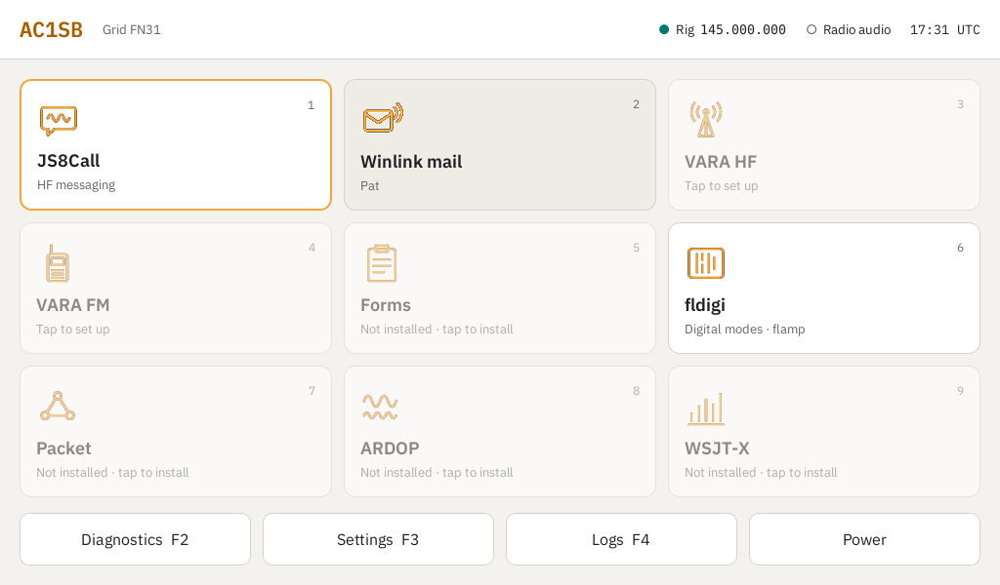

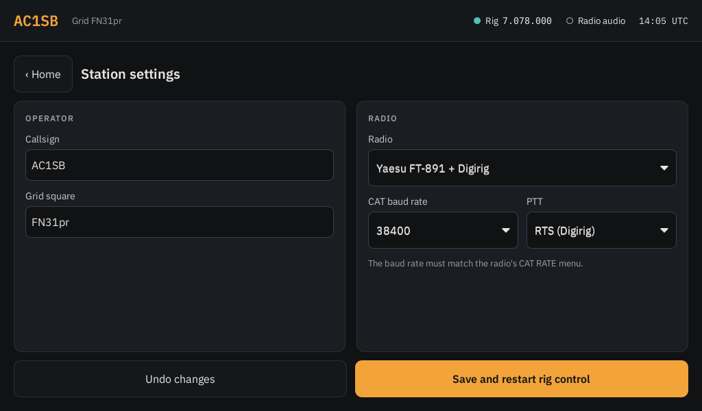

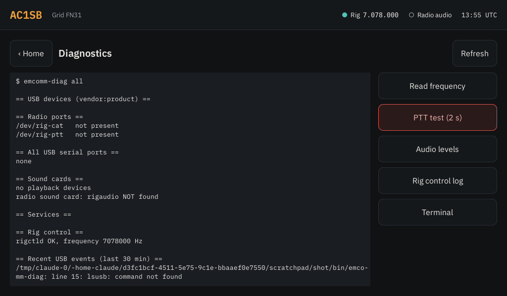

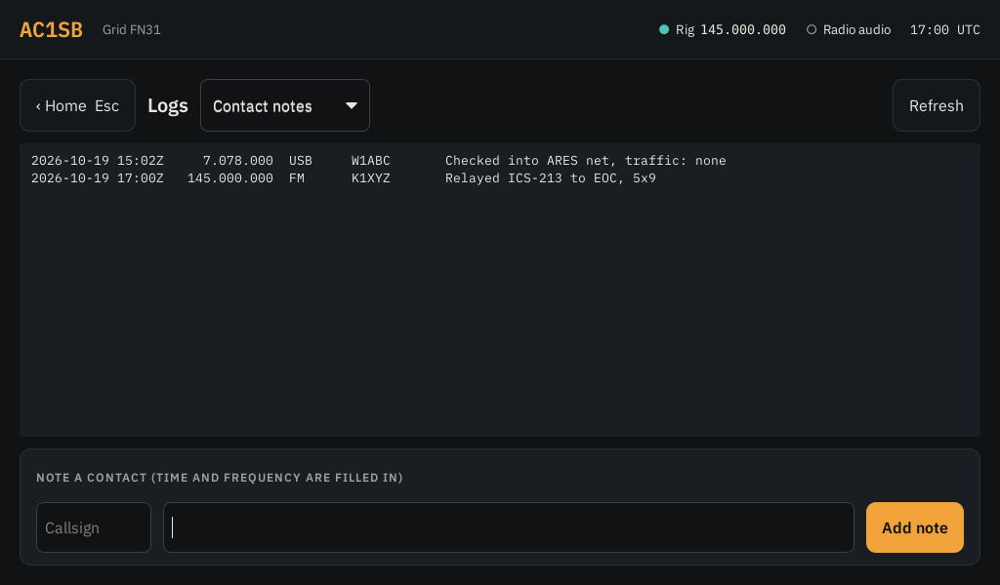

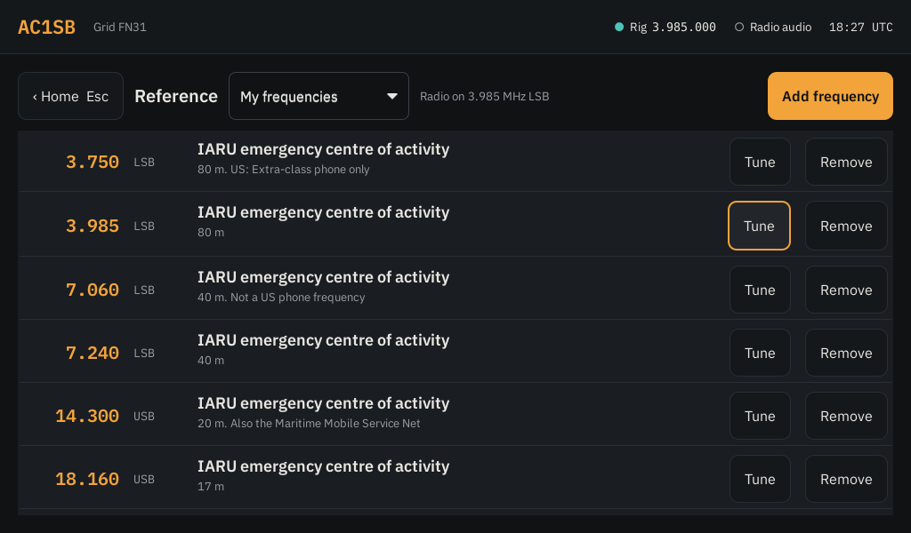

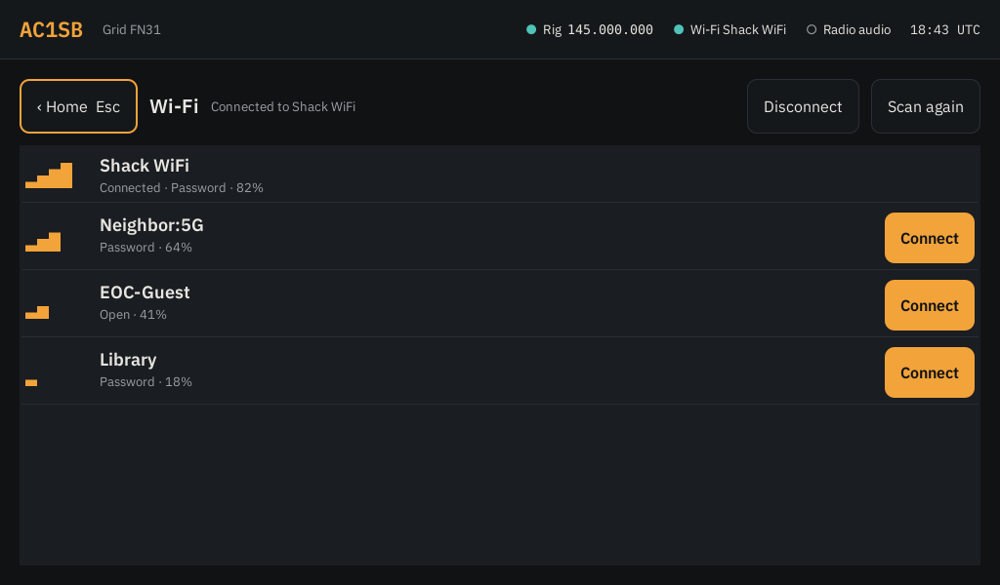

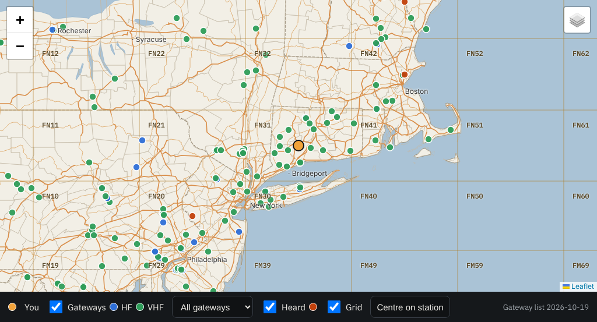

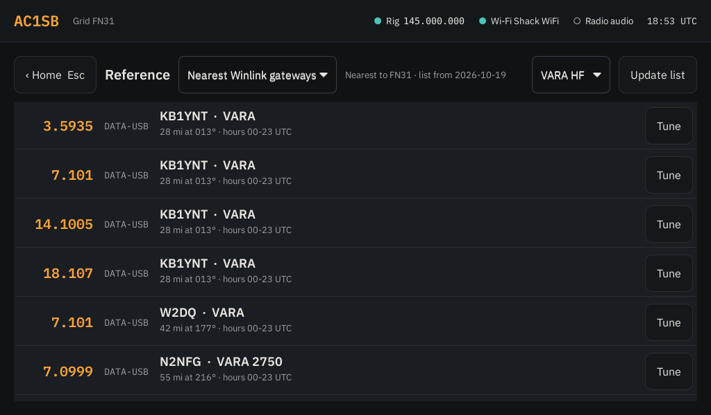

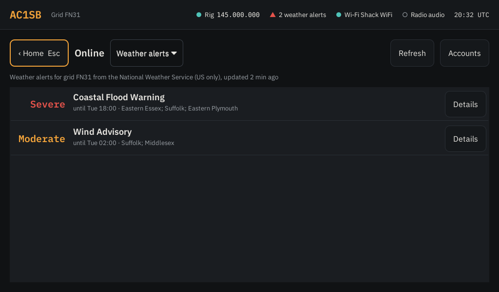

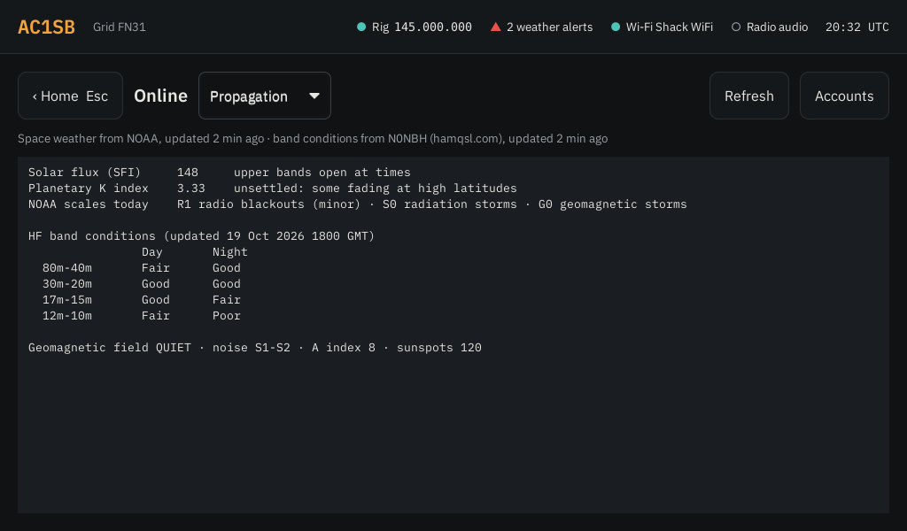

## Using the apps

- **Winlink over VARA:** tap VARA HF (or FM) first. The first tap sets up Wine and
  installs VARA from a setup .zip in `~/Downloads` or on a USB stick; if there isn't
  one, it opens Winlink's download page so you can tap the file. VARA uses the default sound card, which is the radio. Then
  open Winlink mail (Pat), which keys the radio through `rigctld`. On first use, set
  your Winlink password in Pat's configuration page.
- **Winlink over ARDOP or packet:** start ARDOP or Packet from their tiles, then use
  Pat as above.
- **JS8Call and WSJT-X** start with your callsign, grid and rig control filled in
  (radio "Hamlib NET rigctl", PTT by CAT).
- **Audio:** whenever the radio's sound card is plugged in, the station makes it the
  default speaker and microphone, so apps left on their "default" sound device use
  the radio. (`emcomm-audio-default` does this; Diagnostics shows the current default.)
- **APRS:** the APRS tile starts Direwolf (1200 baud, for 2 m APRS on 144.390 MHz
  in North America) and opens Xastir with your callsign, and your position taken
  from the centre of your grid square. Direwolf stops when Xastir closes. Xastir
  only fills in its radio connection the first time, so changes you make in
  Interface Control stick. For HF APRS at 300 baud, put your own Direwolf settings
  in `~/.config/emcomm/direwolf.custom.conf`.
- **APRS radio and iGate** (Settings > APRS iGate): a second radio kept on 144.390
  MHz for APRS, through its own Digirig (for an Icom ID-5100: a Digirig Mobile and
  Digirig's "ICOM RJ-45 Cable for Digirig Mobile", in the mic jack and SP1). Pick
  its sound card (listed by USB socket, so it can be a Digirig just like the main
  radio's: keep it in the same socket) and the Digirig's serial port for PTT. The
  APRS tile then uses that radio. The iGate runs Direwolf in the background:
  **Receive only** passes packets heard on the radio to the internet (APRS-IS) and
  sends the station's position there, never keying the radio; **Two-way** also
  sends messages from APRS-IS to stations heard nearby on the air and beacons there
  every 30 minutes. The APRS-IS passcode is worked out from your callsign; the
  iGate uses SSID -10 unless you pick another, and the centre of your grid square
  unless you give a latitude and longitude. Xastir keeps working alongside it on
  the same Direwolf. For your own Direwolf settings, use
  `~/.config/emcomm/direwolf-igate.custom.conf` (iGate) or
  `direwolf-aprs.custom.conf` (APRS tile with the iGate off).
- **Meshtastic and MeshCore:** plug the node in by USB, or turn on its Bluetooth,
  and tap its tile (Mesh text or MC text). The tile finds the node's USB port (skipping the radio's CAT
  and PTT ports). With no USB node it searches for Bluetooth radios for 10 seconds
  and asks which one; the first time, it pairs and asks for the radio's PIN
  (Meshtastic shows it on its screen, or uses 123456 on a node without one;
  MeshCore uses 123456 unless you changed it). After that the paired radio is
  offered by name, next to any USB nodes and "Search for a Bluetooth radio".
  Bluetooth needs an adapter in the station computer (most mini-PCs and laptops
  have one). Mesh text opens `contact`, a full-screen
  text client for messages, nodes and settings; MC text opens `meshcore-cli`,
  where `?` lists its commands. The **Meshtastic** tile is Meshtastic's own
  app (the Android app's desktop build) with messages, nodes, a map and every
  setting by touch; pair a Bluetooth radio once with Mesh text first. The
  **MeshCore** tile is Meshy, a touch-friendly MeshCore app (GTK) with messages,
  contacts, a map and device settings.
- **CHIRP:** for programming a handheld or mobile over its programming cable (the
  FT-710 and FT-891 don't need it). The station keeps
  `~/My frequencies for CHIRP.csv` up to date with the FM channels from My
  frequencies, offset and tone included (rows noted "Receive only" are left out). In CHIRP, download from the radio first,
  then use File > Import to add that file's channels, and upload to the radio.
  CHIRP is built from its source on GitHub, the same code as its daily builds
  (set `apps_chirp_version` in `roles/apps/defaults/main.yml` to a commit or tag
  to stay on one). Its download site turns away scripts, so it isn't used.
- **Scanner** (tile, any SDR): plug in an SDR receiver with a VHF/UHF antenna
  and tap Scanner. It scans `~/Scanner channels.csv`, which starts as Vermont's
  emergency channels (law enforcement, fire/EMS, interop/EOC, 347 channels), and
  stops on any channel with a signal. An **Airband** group is added to any list:
  Guard 121.5, search and rescue 123.1, MULTICOM, air to air (fixed wing and
  helicopters), the Bennington/Rutland CTAF 122.8, Albany Approach, Boston Center
  and Albany Tower/Ground (from the FAA Chart Supplement); untick it to leave it
  out. Airband is AM, so it needs an antenna for about 120-135 MHz (a 2 m/70 cm
  antenna hears nearby aircraft; a discone or an airband quarter-wave of about
  58 cm does better). Tick or untick groups on the left, and pick
  how far away to listen (10, 25, 50, 100 miles or everywhere) from the grid
  square in Settings > User; statewide channels with no site are always kept.
  **Hold** stays on the channel, tapping a channel in the list holds there,
  **Skip** moves on, **Lock out** (or untick a channel) leaves it out of the scan.
  **Stay on a signal** sets how long it listens once it stops: until the
  channel goes quiet (with 2, 5 or 10 seconds left for a reply), or a set time
  (5, 10, 15, 30 seconds or 1 minute) from when the signal was found, then it
  moves on even if the talking goes on. A held channel stays until you move on.
  **Tune** opens a keypad to listen on any frequency the receiver reaches, and
  **Save to list** adds it to your list in the group My channels; the − and +
  beside the frequency step 12.5 kHz (5 kHz below 50 MHz).
  **Tone squelch** only stops when the channel's own PL tone is there, so other
  users of the frequency are skipped (DPL channels stop on any signal). Squelch 1
  opens on almost anything, 9 needs a strong signal; 4 suits most antennas.
  **Load a list** takes any CSV with a Frequency column (MHz), for example a
  RadioReference export, from a USB stick; Alpha Tag, Group, Agency, County,
  Tone, Mode, Latitude and Longitude columns are used when present. Analog FM
  and AM (Mode AM, or anything in 108-137 MHz with no Mode): P25, DMR and other
  digital channels are listed but not scanned.
  **Receiver** picks which SDR to use (Automatic takes an RTL-SDR, or another
  receiver when the weather radio has the RTL-SDR) and sets the gain and
  frequency correction (ppm). Audio plays on the station's speaker.
- **Gqrx** (tile, any SDR): a waterfall receiver for receive-only listening
  anywhere a receiver reaches, HF included, with the scanner's channel list as its
  bookmarks (one tag per group). With more than one receiver plugged in it asks
  which; each keeps its own Gqrx settings. Receivers that work: RTL-SDR (VHF/UHF;
  an RTL-SDR Blog V4 also does HF, and other RTL-SDR dongles get an "on HF (direct
  sampling)" choice for 0.5 to 28.8 MHz with the antenna on the dongle's input),
  Airspy HF+ and Discovery, Airspy R2/Mini, HackRF, LimeSDR, bladeRF, and any
  other SoapySDR receiver. SDRplay receivers need SDRplay's own API and the
  SoapySDRPlay3 driver installed by hand (SDRplay doesn't allow Debian to ship
  them). Airspy HF+ support depends on Debian packaging its SoapySDR driver.
  The weather radio alert listener uses the first RTL-SDR (not counting the
  ADS-B one): while the Scanner or
  Gqrx has that dongle, alerts pause (the Online page says so) and resume when it
  closes; with a second receiver plugged in, the Scanner uses that instead.
  Settings > Devices lists the SDR receivers plugged in. With no receiver
  plugged in, the Gqrx tile still opens Gqrx: **Practice signal** plays a
  made-up recording around 146.5 MHz (an FM signal on 146.520, Morse code and a
  carrier) to learn it with, and **Network receiver** uses an RTL-SDR on another
  computer shared with `rtl_tcp -a 0.0.0.0` (type its address; it's remembered).
  Press Gqrx's ▶ button to start. Closing Gqrx always frees the receiver: if
  Gqrx hangs on after its window has gone, it's stopped after a few seconds, and
  the Scanner stops a leftover Gqrx itself before giving up. **Settings >
  Devices > Free the SDR receiver** closes Gqrx, the Scanner or anything else
  holding a receiver (rtl_tcp and the like), forcefully if it doesn't close.
- **fldigi:** in Configure > Rig control > Hamlib, pick "Hamlib NET rigctl" with
  device `localhost:4532`, and pick the sound card under Audio.

Several sound-card apps can listen at once; transmit from one at a time, and
don't run two apps that both set the radio's frequency (WSJT-X and JS8Call, say).

## Try it on a computer you already use (desktop mode)

Emcomm-CNC can also run on top of a Debian or Ubuntu computer that's already set
up, to try it out or demo it without wiping anything. It adds an **Emcomm-CNC**
app to your app menu and an **Emcomm-CNC** session to your login screen, and talks
to the radio, GPS and SDR the same way the station does (no sandbox in the way).
Your desktop, login, boot screen, clock and other programs are left as they are.

It's tested on Ubuntu 24.04, and should work on Ubuntu 22.04, Linux Mint 22 and
Debian 12 or 13. VARA, Pat and ardopcf need a 64-bit PC (x86-64).

### Install

Open a terminal and run:

```sh
sudo apt install -y git
git clone https://github.com/ac1sb/emcomm-station.git
cd emcomm-station
sudo ./install-desktop.sh
```

It asks for your password, installs Ansible, copies itself to
`/opt/emcomm-station` and sets Emcomm-CNC up for your account. That takes a few
minutes. **Log out and back in once** afterwards, so your account can use the
radio's serial ports and USB devices.

Apps aren't installed up front: tap a tile and it offers to install that app.
Settings > Update station gets the latest Emcomm-CNC, as on the station.

### Run it

- **From the app menu:** open **Emcomm-CNC**. It fills the screen; when you start
  an app from a tile, the launcher steps aside so the app is in front. To get at
  the rest of your desktop, tap **—** in the top bar (or press **Ctrl+M**, or
  **⏻ > Minimize**). To bring it back, click Emcomm-CNC in your taskbar or dock,
  use Alt+Tab, or open **Emcomm-CNC** from the app menu again: that brings back
  the one already running rather than starting a second. To leave, tap
  **⏻ > Power…** and choose **Exit Emcomm-CNC**.
- **As its own session:** on the login screen, pick **Emcomm-CNC** before typing
  your password (on Ubuntu, click your name, then the gear button at the bottom
  right). You get the full station: the Home bar across the top, apps opening
  full screen below it. **⏻ > Power… > Log out** returns to the login screen.

On Ubuntu's normal session (Wayland), the launcher can't bring an app that's
already open to the front, and Settings > Display only changes the colours and
text size. The Emcomm-CNC session has everything.

### Sound

The radio apps (fldigi, WSJT-X, JS8Call, Direwolf, VARA) use the computer's
default speaker and microphone. On the station, the radio's sound card is always
that default. On your computer it would also send YouTube, calls and alert
sounds to the radio, so by default the radio is the default **only while
Emcomm-CNC is open**: open it and the radio takes over, exit and your own speaker
and microphone come back. Alert sounds are silenced meanwhile, so a notification
isn't transmitted. **Settings > Audio** shows what's in use now and lets you pick
**Always** (like the station) or **Never** (set each app to the radio's sound
card yourself).

### What it changes, and taking it off

It adds its programs under `/usr/local/bin`, `/usr/share/emcomm` and `/opt`,
the services that run the radio's CAT control (rigctld, started when the radio is
plugged in) and the weather radio receiver, rules that name the radio's USB
ports, and two sudo rules so Settings and Update station work without a password.
It points gpsd at the GPS chosen in Settings (keeping a copy of your gpsd settings)
and stops the TV-tuner driver from taking an RTL-SDR dongle. Your account is
added to the dialout, plugdev and bluetooth groups. It doesn't touch your login,
desktop, boot screen, clock, network settings, firewall, update settings or SSH.

To take it all off again:

```sh
sudo /opt/emcomm-station/uninstall-desktop.sh
```

That removes everything above and puts your gpsd settings back. Add
`--packages` to also see the packages it installed and choose to remove them.
Your own files stay: `~/.config/emcomm`, recordings, frequency lists and the
apps' settings.

## Install

You need an x86-64 computer (a mini PC or laptop; VARA won't run on a Raspberry
Pi), a USB stick of 2 GB or more for the installer, and a wired internet
connection for the install if you can (Wi-Fi works too, see step 2).

### 1. Make the Debian installer stick

1. On any computer, download the Debian 13 "netinst" image for **amd64** from
   <https://www.debian.org/distrib/netinst>.
2. Write it to the USB stick with [balenaEtcher](https://etcher.balena.io/),
   [Raspberry Pi Imager](https://www.raspberrypi.com/software/) ("Use custom") or
   Rufus on Windows (choose "DD image" if it asks). This erases the stick.

### 2. Install Debian

Boot the station from the stick (usually F12, F2 or Esc at power-on opens the boot
menu) and choose **Install** (text) or **Graphical install**. Answer the questions
like this; anything not listed can be left at its default.

| Installer question | Answer |
| --- | --- |
| Language, location, keyboard | Yours |
| Network | Pick the wired port if plugged in, or your Wi-Fi network and password. Wi-Fi set up here keeps working after the install. |
| Hostname | `emcomm` (or any name). Leave the domain blank. |
| Root password | Either works. **Set one** and you'll use `su -` to become root. **Leave it blank** and Debian instead gives your admin user `sudo`, and you'll use `sudo -i`. |
| Full name / username / password | Your own admin account, for example `admin`. **Don't** call it `radio`: the build creates that user for the station screen. |
| Partitioning | Guided – use entire disk → the station's disk → All files in one partition → Finish → Yes. This erases that disk. |
| Package mirror | Your country → `deb.debian.org`, no proxy |
| Popularity contest | No |
| Software selection | **Untick** "Debian desktop environment" and "GNOME". **Tick only** "SSH server" and "standard system utilities". |
| Install GRUB | Yes, on the station's disk |

Remove the stick when it says the installation is complete, and let it reboot to a
text login prompt.

### 3. Build the station

Log in as your admin user, then become root: `su -` (and the root password) if you
set one in step 2, or `sudo -i` (and your own password) if you left it blank. Then
run the build:

```sh
apt update
apt install -y ansible git
git clone https://github.com/ac1sb/emcomm-station.git /root/emcomm-station
cd /root/emcomm-station
ansible-playbook site.yml
reboot
```

The build downloads about 1–2 GB (the radio apps and Wine), so it takes a while.
It ends with a summary where `failed=0` means it worked. If it stops with an error,
run `ansible-playbook site.yml` again; it picks up where it left off.

Keep the checkout at `/root/emcomm-station`, owned by root: Update station rebuilds
from there and refuses a folder that other users could change.

### 4. First boot: Settings

The station boots straight into the Settings screen.

1. Set the radio's CAT baud rate in its menu (on the FT-891 and FT-710: CAT RATE,
   38400 is a good choice), connect it by USB (and the Digirig, if you use one), and
   switch it on.
2. Enter your **callsign** and **grid square**.
3. Pick a **preset** if there's one for your setup, or pick the radio's
   **manufacturer** and **model**, then the **CAT port**, **PTT** method and port, and
   the **sound card** from the lists of plugged-in devices. Leave **GPS** on
   Automatic unless your GPS isn't a u-blox. Tap **Rescan devices** if
   you plugged something in after opening Settings.
4. Check the **baud rate** matches the radio and tap **Save and restart rig control**.

### 5. Check the radio

Open **Diagnostics** (F2). "Read frequency" should show the radio's frequency, the
sound card should be listed as `rigaudio`, and "PTT test" should key the radio for 2
seconds (connect an antenna or dummy load first).

### 6. Set up the apps

- **VARA HF / VARA FM:** tap the tile. The first time, Winlink's download page
  opens: tap "VARA HF … setup.zip" (or VARA FM). A green "Saved" bar shows and the
  window closes by itself, then setup carries on (Wine takes several
  minutes the first time). Winlink doesn't allow scripted downloads, which is why
  this step is yours. Without internet on the station, download the .zip on another
  computer, put it on a USB stick, plug it in and tap the tile.
- **Winlink mail (Pat):** open it and, on Pat's configuration page, enter your
  Winlink password. Callsign, grid and rig control are already filled in.
- **JS8Call, WSJT-X, Forms, Packet, ARDOP, APRS, Meshtastic and MeshCore** are
  ready to use once installed from their tiles. fldigi needs its rig
  control pointed at `localhost:4532` once (see "Using the apps" above).

### Backing up

Plug in a USB stick, open **Settings** and tap **Backup**, then **Back up now**. The
backup (`EmcommBackup/emcomm-backup-CALL-DATE.tar.gz` on the stick) holds the
station settings, contact notes, nets, ICS forms, My frequencies, tile pictures,
Winlink mail, and the apps' settings and logs. To move to a rebuilt or spare
station, plug the stick in there, tap **Backup** and **Restore** next to the
backup. Passwords and keys aren't in the backup, so a lost stick gives none away:
enter them again after a restore (Accounts on the Online page, and Pat's Winlink
password).

### Updating

Tap **Update station** in Settings. It downloads the latest Emcomm-CNC and installs
anything new or missing; settings are kept. You can also re-run the build by hand
as root: `cd /root/emcomm-station && git pull && ansible-playbook site.yml`.

### Accounts

The station user (`radio`) logs in automatically, has no password and can't use
`sudo` or `apt` in the terminal. That's deliberate: installing apps and updating go
through the launcher's buttons. For anything else, open the terminal in Diagnostics
and run `su -` (root password), or, if you left the root password blank,
`su - admin` (your admin username) followed by `sudo -i`. You can also log in over
SSH from another computer as your admin user; `hostname -I` in the Diagnostics
terminal shows the station's address.

Ubuntu Server 24.04 should also work if your hardware needs newer drivers.

### If something goes wrong

- **Update station (or installing an app) fails:** the end of the window says
  which step stopped and why. Everything it printed is saved in
  `/var/log/emcomm-update.log` (the run before in `.1`) and shown on the Logs page
  under **Station updates**. If CHIRP can't install, the rest of the update still
  carries on and the end of the window says so.
- **`su -` says "Authentication failure" with the right password:** the keyboard
  layout may not match what you typed during install (common in VM consoles). Type
  the password in a visible place first, such as the login prompt's username field,
  to check the characters. Or reboot, pick "Advanced options" > "recovery mode" in
  the boot menu, log in there as root and run `dpkg-reconfigure keyboard-configuration`.
- **`ansible-playbook` says it can't find `site.yml`, or the folder only has a
  README:** the copy is out of date. Run `cd /root/emcomm-station && git pull`
  and try again.
- **Update station says the folder "can be changed by" someone, or isn't owned by
  root:** as root, run
  `chown -R root:root /root/emcomm-station && chmod 755 /root/emcomm-station`.
- **Anything about a package that "is not available":** run `apt update`, then the
  build again. If it still fails, note the package name and open an issue.

## Testing in a VM

A VM is fine for checking the build, the kiosk and the launcher. Snapshot it before
the first run. For on-air testing use real hardware: USB audio passed through to a
VM tends to drop samples, which VARA and FT8 don't tolerate.

## Adding a preset

No file is needed to use a radio. To add a one-tap preset, see
[radios/README.md](radios/README.md).

## Development

```sh
pip install ansible-core ansible-lint shellcheck-py pyyaml
ansible-playbook site.yml --syntax-check
ansible-lint
python3 tests/test_apply_settings.py
python3 tests/test_app_setup.py
```
