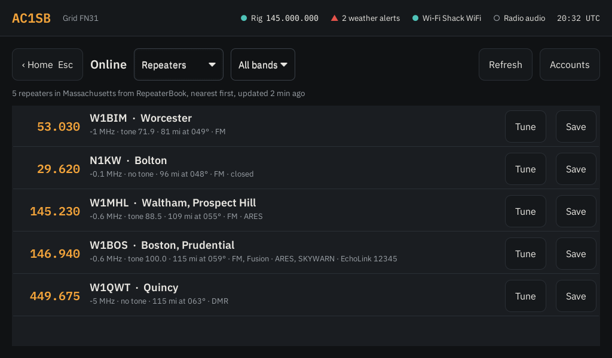

# Emcomm-CNC

*Emcomm command and control.*

Turns a fresh minimal Debian 13 install into a dedicated emcomm station: it boots
straight into a full-screen touch launcher for the radio apps, with no desktop
environment.


## What's in it so far

- **Base system:** a `radio` user, SSH for remote troubleshooting, PipeWire audio.
- **Settings screen:** callsign, grid and the radio, set on the station itself and
  opened automatically on first boot. Any radio Hamlib supports can be picked by
  manufacturer and model; the CAT port, PTT port and sound card are picked from the
  USB devices that are plugged in, with a Rescan button. Saving gives those devices
  stable names (`/dev/rig-cat`, `/dev/rig-ptt`, ALSA card `rigaudio`) and restarts
  Hamlib's `rigctld`, which every app uses to reach the radio on `127.0.0.1:4532`.
  `rigctld` starts by itself whenever the radio is plugged in.
- **Presets** (`radios/`): Yaesu FT-891 with a Digirig, and Yaesu FT-710. Optional
  shortcuts that fill in every radio field at once, even before the radio is plugged in.
- **Kiosk:** auto-login on the console, X with Openbox only, screen blanking off.
- **Launcher:** the home screen above. Works by touch, mouse or keyboard: Tab moves
  between buttons, 1–9 open tiles, Esc/F1 goes Home, F2 Diagnostics, F3 Settings,
  F4 Logs, F5 Reference, F6 Wi-Fi. A tile for an app that isn't installed says "tap to install". To use
  your own picture on a tile, long-press it (or right-click, or press the Menu key)
  and pick an SVG, PNG or JPG from a USB stick or `~/Downloads`; "Use the standard
  icon" puts it back. **Light mode** / **Dark mode** in Settings switches the colours
  (light is easier to read in daylight); the choice is remembered.
- **Radio apps:** JS8Call, WSJT-X, fldigi with flamp, flmsg (ICS-213 forms), Pat for
  Winlink mail, VARA HF and VARA FM (under Wine), ARDOP (ardopcf), Direwolf for
  packet, Xastir for APRS, and the Meshtastic (`contact`) and MeshCore
  (`meshcore-cli`) clients for LoRa mesh radios. Every app reaches the radio through `rigctld`, so CAT and PTT are set up
  once, in Settings. Callsign and grid are filled in for each app.
- **Logs:** JS8Call messages and activity, WSJT-X contacts and Winlink mail in one
  place, plus a box to note a voice or other contact. Notes get the UTC time,
  frequency and mode from the radio.
- **Reference** (F5): the US band plan with a which-band-when guide, emergency and
  calling frequencies (IARU emergency centres of activity, Hurricane Watch Net,
  SATERN, 60 m channels, simplex calling, APRS), and JS8Call and FT8 dial
  frequencies. **Tune** puts the radio on that frequency and mode. **Add
  frequency** saves the radio's current frequency (or one you type) to **My
  frequencies** with a name and note, for local nets and repeaters. The lists are
  CSV files (`MHz,Mode,Name,Note`) in `/usr/share/emcomm/reference`; a file of the
  same name in `~/.local/share/emcomm/reference` replaces the standard one.
- **Nearest Winlink gateways** (on the Reference page): every gateway channel from
  Pat's list, nearest to your grid first, with distance, bearing, mode and hours.
  Pick VARA HF, ARDOP, VARA FM or Packet to narrow it, and **Tune** puts the radio
  on the gateway's dial frequency (centre minus 1.5 kHz on HF, as Pat does). It
  works offline from Pat's saved list; **Update list** downloads a fresh one when
  the station has internet. The nearest HF gateway isn't always the easiest to
  reach: within about 300 miles, NVIS on 80 m or 40 m (or 60 m) works best.
- **Map** (tile): an offline map (countries, states, US counties, highways and towns
  from Natural Earth) with Maidenhead grid squares, your station, every Winlink
  gateway (blue HF, green VHF/UHF; tap one for its dial frequencies, modes and
  hours) and stations heard on JS8Call and WSJT-X with their grids. The gateway
  list is Pat's: it works offline from the copy built into Pat, and is refreshed
  when it's over a week old and the station is online. It also shows what the
  Online page last saved: stations that heard you (purple, with a line to each)
  and the nearest 300 repeaters.
- **Online** (F7): data from internet services, saved so the last answer still
  shows offline. Each section says when it was last updated.
  - **Weather alerts** for your grid from the National Weather Service (US only),
    most severe first; **Details** shows the full text. Alerts in force also show in
    the top bar; tap there to read them. Checked every ten minutes when online.
  - **Propagation:** solar flux, K index and the NOAA R/S/G scales from NOAA's Space
    Weather Prediction Center, and day/night HF band conditions from N0NBH
    (hamqsl.com), with a line on what the numbers mean.
  - **Who heard me:** stations that reported your signal to PSKReporter in the last
    six hours, with distance, band, mode and SNR. Transmit FT8, JS8 or another
    digital mode first; reports come from stations that are online.
  - **Repeaters** near you from RepeaterBook, nearest first, filtered by band.
    **Tune** sets frequency, FM, offset and tone (for radios that cover the band);
    **Save** adds it to My frequencies.
  - **Callsign lookup:** name, address, grid, distance and licence from QRZ (or
    HamQTH if there's no QRZ login), plus the last APRS position from aprs.fi.
    Callsigns looked up before still show offline.
  - **Accounts:** a contact email (sent to NOAA, PSKReporter and RepeaterBook so they
    know who's asking), QRZ and HamQTH logins, the aprs.fi API key, the RepeaterBook
    token and your state or country. They're saved in
    `~/.config/emcomm/accounts.json`, readable only by the station user. Alerts,
    propagation and PSKReporter need no account. QRZ gives full records only to
    XML Logbook Data subscribers. For RepeaterBook, request API access at
    <https://www.repeaterbook.com/api/token_request.php> (see below).
- **Browser** (tile): Chromium, with a Ham radio bookmarks bar (World Radio League,
  QRZ, PSKReporter, aprs.fi, RepeaterBook, NWS, space weather, Winlink, WebSDR,
  LoTW). The list is `apps_browser_bookmarks` in `roles/apps/defaults/main.yml`.
- **Wi-Fi** (F6, the **Wi-Fi** button in Settings, or tap the network status at the
  top): lists nearby networks by signal strength; tap **Connect** and type the
  password. The station remembers networks it has joined. If the Debian installer
  set up Wi-Fi itself (installing over Wi-Fi), the page says so: remove the Wi-Fi
  lines from `/etc/network/interfaces` and restart to manage it here instead.
- **Update station** (in Settings): downloads the latest Emcomm-CNC and installs
  anything missing, with progress on screen. No terminal or password needed.
- **Diagnostics:** USB devices with vendor:product IDs, radio ports, sound cards,
  services, recent USB events, a read-frequency check and a 2-second PTT test.
  The same report is available over SSH with `emcomm-diag`.





## Using the apps

- **Winlink over VARA:** tap VARA HF (or FM) first. The first tap sets up Wine and
  installs VARA from a setup .zip in `~/Downloads` or on a USB stick; if there isn't
  one, it opens Winlink's download page so you can tap the file. VARA uses the default sound card, which is the radio. Then
  open Winlink mail (Pat), which keys the radio through `rigctld`. On first use, set
  your Winlink password in Pat's configuration page.
- **Winlink over ARDOP or packet:** start ARDOP or Packet from their tiles, then use
  Pat as above.
- **JS8Call and WSJT-X** start with your callsign, grid and rig control filled in
  (radio "Hamlib NET rigctl", PTT by CAT).
- **Audio:** whenever the radio's sound card is plugged in, the station makes it the
  default speaker and microphone, so apps left on their "default" sound device use
  the radio. (`emcomm-audio-default` does this; Diagnostics shows the current default.)
- **APRS:** the APRS tile starts Direwolf (1200 baud, for 2 m APRS on 144.390 MHz
  in North America) and opens Xastir with your callsign, and your position taken
  from the centre of your grid square. Direwolf stops when Xastir closes. Xastir
  only fills in its radio connection the first time, so changes you make in
  Interface Control stick. For HF APRS at 300 baud, put your own Direwolf settings
  in `~/.config/emcomm/direwolf.custom.conf`.
- **Meshtastic and MeshCore:** plug the node in by USB and tap its tile. The tile
  finds the node's USB port (skipping the radio's CAT and PTT ports) and asks which
  one if more than one is plugged in. Meshtastic opens `contact`, a full-screen
  text client for messages, nodes and settings; MeshCore opens `meshcore-cli`,
  where `?` lists its commands.
- **fldigi:** in Configure > Rig control > Hamlib, pick "Hamlib NET rigctl" with
  device `localhost:4532`, and pick the sound card under Audio.

Running more than one sound-card app at a time doesn't work: close one before
opening the next.

### Getting a RepeaterBook token

RepeaterBook's API needs approval, which is free for non-commercial use but up to
RepeaterBook.

1. Sign in at <https://www.repeaterbook.com> (a free account).
2. Fill in the request form at <https://www.repeaterbook.com/api/token_request.php>.
   Say it's a non-commercial, single-user station (not a server or a distributed
   app), and give:
   - **App name:** Emcomm-CNC
   - **User-Agent:** `Emcomm-CNC/1.0 (+https://github.com/ac1sb/emcomm-station; you@example.org)`,
     with the email you put under Online > Accounts. The station sends exactly
     this, and RepeaterBook may refuse requests whose User-Agent doesn't match.
   - **What it does:** downloads my state's repeater list about once a week, kept
     on this station so it works offline during emergencies; not shared or
     redistributed.
3. Once approved, the token is on <https://www.repeaterbook.com/user/api_apps.php>.
   It's shown only once, so copy it then.
4. On the station, open Online > Accounts, paste it as the RepeaterBook token, pick
   your state, and save. The Repeaters section downloads the list.

## Install

You need an x86-64 computer (a mini PC or laptop; VARA won't run on a Raspberry
Pi), a USB stick of 2 GB or more for the installer, and a wired internet
connection for the install if you can (Wi-Fi works too, see step 2).

### 1. Make the Debian installer stick

1. On any computer, download the Debian 13 "netinst" image for **amd64** from
   <https://www.debian.org/distrib/netinst>.
2. Write it to the USB stick with [balenaEtcher](https://etcher.balena.io/),
   [Raspberry Pi Imager](https://www.raspberrypi.com/software/) ("Use custom") or
   Rufus on Windows (choose "DD image" if it asks). This erases the stick.

### 2. Install Debian

Boot the station from the stick (usually F12, F2 or Esc at power-on opens the boot
menu) and choose **Install** (text) or **Graphical install**. Answer the questions
like this; anything not listed can be left at its default.

| Installer question | Answer |
| --- | --- |
| Language, location, keyboard | Yours |
| Network | Pick the wired port if plugged in, or your Wi-Fi network and password. Wi-Fi set up here keeps working after the install. |
| Hostname | `emcomm` (or any name). Leave the domain blank. |
| Root password | Either works. **Set one** and you'll use `su -` to become root. **Leave it blank** and Debian instead gives your admin user `sudo`, and you'll use `sudo -i`. |
| Full name / username / password | Your own admin account, for example `admin`. **Don't** call it `radio`: the build creates that user for the station screen. |
| Partitioning | Guided – use entire disk → the station's disk → All files in one partition → Finish → Yes. This erases that disk. |
| Package mirror | Your country → `deb.debian.org`, no proxy |
| Popularity contest | No |
| Software selection | **Untick** "Debian desktop environment" and "GNOME". **Tick only** "SSH server" and "standard system utilities". |
| Install GRUB | Yes, on the station's disk |

Remove the stick when it says the installation is complete, and let it reboot to a
text login prompt.

### 3. Build the station

Log in as your admin user, then become root: `su -` (and the root password) if you
set one in step 2, or `sudo -i` (and your own password) if you left it blank. Then
run the build:

```sh
apt update
apt install -y ansible git
git clone https://github.com/ac1sb/emcomm-station.git /root/emcomm-station
cd /root/emcomm-station
ansible-playbook site.yml
reboot
```

The build downloads about 1–2 GB (the radio apps and Wine), so it takes a while.
It ends with a summary where `failed=0` means it worked. If it stops with an error,
run `ansible-playbook site.yml` again; it picks up where it left off.

Keep the checkout at `/root/emcomm-station`, owned by root: Update station rebuilds
from there and refuses a folder that other users could change.

### 4. First boot: Settings

The station boots straight into the Settings screen.

1. Set the radio's CAT baud rate in its menu (on the FT-891 and FT-710: CAT RATE,
   38400 is a good choice), connect it by USB (and the Digirig, if you use one), and
   switch it on.
2. Enter your **callsign** and **grid square**.
3. Pick a **preset** if there's one for your setup, or pick the radio's
   **manufacturer** and **model**, then the **CAT port**, **PTT** method and port, and
   the **sound card** from the lists of plugged-in devices. Tap **Rescan devices** if
   you plugged something in after opening Settings.
4. Check the **baud rate** matches the radio and tap **Save and restart rig control**.

### 5. Check the radio

Open **Diagnostics** (F2). "Read frequency" should show the radio's frequency, the
sound card should be listed as `rigaudio`, and "PTT test" should key the radio for 2
seconds (connect an antenna or dummy load first).

### 6. Set up the apps

- **VARA HF / VARA FM:** tap the tile. The first time, Winlink's download page
  opens: tap "VARA HF … setup.zip" (or VARA FM). A green "Saved" bar shows and the
  window closes by itself, then setup carries on (Wine takes several
  minutes the first time). Winlink doesn't allow scripted downloads, which is why
  this step is yours. Without internet on the station, download the .zip on another
  computer, put it on a USB stick, plug it in and tap the tile.
- **Winlink mail (Pat):** open it and, on Pat's configuration page, enter your
  Winlink password. Callsign, grid and rig control are already filled in.
- **JS8Call, WSJT-X, Forms, Packet, ARDOP, APRS, Meshtastic and MeshCore** are
  ready to use once installed from their tiles. fldigi needs its rig
  control pointed at `localhost:4532` once (see "Using the apps" above).

### Updating

Tap **Update station** in Settings. It downloads the latest Emcomm-CNC and installs
anything new or missing; settings are kept. You can also re-run the build by hand
as root: `cd /root/emcomm-station && git pull && ansible-playbook site.yml`.

### Accounts

The station user (`radio`) logs in automatically, has no password and can't use
`sudo` or `apt` in the terminal. That's deliberate: installing apps and updating go
through the launcher's buttons. For anything else, open the terminal in Diagnostics
and run `su -` (root password), or, if you left the root password blank,
`su - admin` (your admin username) followed by `sudo -i`. You can also log in over
SSH from another computer as your admin user; `hostname -I` in the Diagnostics
terminal shows the station's address.

Ubuntu Server 24.04 should also work if your hardware needs newer drivers.

### If something goes wrong

- **`su -` says "Authentication failure" with the right password:** the keyboard
  layout may not match what you typed during install (common in VM consoles). Type
  the password in a visible place first, such as the login prompt's username field,
  to check the characters. Or reboot, pick "Advanced options" > "recovery mode" in
  the boot menu, log in there as root and run `dpkg-reconfigure keyboard-configuration`.
- **`ansible-playbook` says it can't find `site.yml`, or the folder only has a
  README:** the copy is out of date. Run `cd /root/emcomm-station && git pull`
  and try again.
- **Update station says the folder "can be changed by" someone, or isn't owned by
  root:** as root, run
  `chown -R root:root /root/emcomm-station && chmod 755 /root/emcomm-station`.
- **Anything about a package that "is not available":** run `apt update`, then the
  build again. If it still fails, note the package name and open an issue.

## Testing in a VM

A VM is fine for checking the build, the kiosk and the launcher. Snapshot it before
the first run. For on-air testing use real hardware: USB audio passed through to a
VM tends to drop samples, which VARA and FT8 don't tolerate.

## Adding a preset

No file is needed to use a radio. To add a one-tap preset, see
[radios/README.md](radios/README.md).

## Development

```sh
pip install ansible-core ansible-lint shellcheck-py pyyaml
ansible-playbook site.yml --syntax-check
ansible-lint
python3 tests/test_apply_settings.py
python3 tests/test_app_setup.py
```
