# Emcomm-CNC operations guide

*How to operate the Emcomm-CNC station for ARES/RACES work and everyday
preparedness: what each app is for, which apps work together, what to open first,
and the radio, rig and audio settings for each one.*

## How to use this guide

- **Never used this station?** Read [Part 1: Cold start](#part-1-cold-start). It
  gets you from power-on to a logged net check-in, a sent ICS-213 and a Winlink
  email, with nothing else assumed. Keep a printed copy of Part 1 in the go-kit.
- **Know the station?** [Part 2](#part-2-operating-the-station) is the reference,
  one chapter per app: what it's for, what to open first, its rig and audio
  settings, and how to tell it's working.
  [Part 3](#part-3-ares-and-races-walkthroughs) walks through whole jobs during an
  activation, and [Part 4](#part-4-radio-settings-troubleshooting-and-files) has
  the radios' own menu settings, troubleshooting and where files are kept.

Building and installing the station are covered in the
[README](https://github.com/ac1sb/emcomm-station#readme). This guide starts with the
station already set up. On the station, the **Guide** tile on Home shows this guide,
and its **Print** button prints it or saves a PDF to a USB stick.

> ⚠ **Not yet tested on this station** marks features that work in the build but
> haven't yet been run with real radios here. Treat the steps as right and the
> results as unconfirmed.

Every time and date the station writes (forms, logs, recordings, net logs) is in
**UTC**. The top bar shows local time and UTC side by side.

## Contents

**Part 1: Cold start**

- [Turn it on](#turn-it-on)
- [Is it working? The top bar](#is-it-working-the-top-bar)
- [What do you need to do?](#what-do-you-need-to-do)
- [Check in to a voice net and log it](#check-in-to-a-voice-net-and-log-it)
- [Write an ICS-213 and send it by radio](#write-an-ics-213-and-send-it-by-radio)
- [Send a Winlink email](#send-a-winlink-email)
- [Five rules](#five-rules)
- [Shut down](#shut-down)

**Part 2: Operating the station**

- [The station at a glance](#the-station-at-a-glance)
- [Before you operate: the start-up check](#before-you-operate-the-start-up-check)
- [How the pieces fit together](#how-the-pieces-fit-together)
- [Which apps work together, and in what order](#which-apps-work-together-and-in-what-order)
- [Winlink email: Pat with VARA, ARDOP or packet](#winlink-email-pat-with-vara-ardop-or-packet)
- [WSJT-X (FT8)](#wsjt-x-ft8)
- [JS8Call](#js8call)
- [fldigi, flamp and flmsg](#fldigi-flamp-and-flmsg)
- [SSTV: pictures over the air (QSSTV)](#sstv-pictures-over-the-air-qsstv)
- [Forms: ICS-213 messages, nets, ICS-309 and ICS-205](#forms-ics-213-messages-nets-ics-309-and-ics-205)
- [Files: Winlink attachments and downloads](#files-winlink-attachments-and-downloads)
- [Logs](#logs)
- [Recorder and Broadcastify](#recorder-and-broadcastify)
- [Reference and the Winlink gateway finder](#reference-and-the-winlink-gateway-finder)
- [Scanner](#scanner)
- [Gqrx](#gqrx)
- [NOAA radio (weather alerts with no internet)](#noaa-radio-weather-alerts-with-no-internet)
- [APRS and the iGate](#aprs-and-the-igate)
- [Meshtastic and MeshCore](#meshtastic-and-meshcore)
- [Map](#map)
- [Online, Browser and Library](#online-browser-and-library)
- [CHIRP](#chirp)
- [Settings](#settings)
- [Diagnostics](#diagnostics)

**Part 3: ARES and RACES walkthroughs**

- [Activation: the first 15 minutes](#activation-the-first-15-minutes)
- [Run a net as net control](#run-a-net-as-net-control)
- [Pass formal traffic: which way to send it](#pass-formal-traffic-which-way-to-send-it)
- [Send an ICS-213 by Winlink](#send-an-ics-213-by-winlink)
- [Watch public safety and the weather while you operate](#watch-public-safety-and-the-weather-while-you-operate)
- [No internet: what still works](#no-internet-what-still-works)
- [Shift change and end of activation](#shift-change-and-end-of-activation)
- [Preparedness: the monthly check](#preparedness-the-monthly-check)

**Part 4: Radio settings, troubleshooting and files**

- [The radios' own menu settings](#the-radios-own-menu-settings)
- [Troubleshooting](#troubleshooting)
- [Where things are kept](#where-things-are-kept)

---

# Part 1: Cold start

For an operator who has never used this station. Follow it top to bottom. You don't
need to change any settings: the station is already set up for its radio.

## Turn it on

1. **Turn the radio on** and make sure its USB cable goes to the station computer.
   (The FT-710 needs one USB cable; the FT-891 has two, the radio's own and the
   Digirig's.)
2. **Turn the station on.** It starts straight into the Home screen below.

> **Desktop mode** (Emcomm-CNC on an everyday Ubuntu or Debian computer): log in,
> then open **Emcomm-CNC** from the app menu.

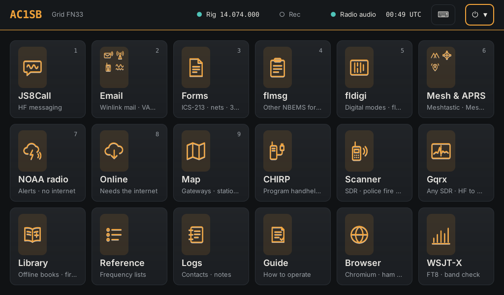

Each square is a **tile**: tap it to open that app. Tiles with several small
pictures, such as **Email** and **Mesh & APRS**, are folders: tap to open, **‹ Home**
or Esc to close. A mouse and keyboard work as well as touch.

## Is it working? The top bar

Look across the top of the screen:

| You see | It means | If not |
| --- | --- | --- |
| ● **Rig 14.074.000** (green dot and a frequency) | The station is talking to the radio | Radio off, or its USB cable is out. Turn it on, plug it in, wait 10 seconds |
| ● **Radio audio** (green dot) | The radio's sound card is plugged in | Same: check the USB cable |
| Speaker and microphone icons | Tap for the listening speaker's volume, or the radio's To radio and From radio levels ([Levels](#levels)) | A microphone with a line through it: the radio's sound card isn't plugged in |
| **UTC** time | Times on everything are UTC | If it's wrong, tell whoever runs the station: digital modes need the right time |
| ▲ **weather alerts** (red) | Weather alerts in force near you | Tap it to read them |

If both dots are green, the station is ready.

## What do you need to do?

| To | Open | Section |
| --- | --- | --- |
| Talk on voice | Nothing: use the radio's microphone | [Check in to a voice net](#check-in-to-a-voice-net-and-log-it) |
| Run or log a net | **Forms** > **New ▾ > Net log** (or F8) | [Run a net](#run-a-net-as-net-control) |
| Write a formal message (ICS-213) | **Forms** > **New ▾ > ICS-213 message** | [Write an ICS-213](#write-an-ics-213-and-send-it-by-radio) |
| Send email over the radio (Winlink) | **Email** folder | [Send a Winlink email](#send-a-winlink-email) |
| Find a frequency, or put the radio on one | **Reference** (F5) | [Reference](#reference-and-the-winlink-gateway-finder) |
| Hear police, fire and EMS | **Scanner** | [Scanner](#scanner) |
| Get weather alerts | **NOAA radio** (no internet) or **Online** | [NOAA radio](#noaa-radio-weather-alerts-with-no-internet) |
| Record what's heard on the radio | **Rec** at the top of the screen | [Recorder](#recorder-and-broadcastify) |
| Read first-aid and how-to books | **Library** | [Library](#library) |

## Check in to a voice net and log it

1. Tap **Reference** (or press F5). Find the net's frequency (your own nets and
   repeaters are under **My frequencies**) and tap **Tune**. The radio goes there.
2. Talk on the radio's microphone as usual. The station doesn't need to be involved
   in voice.
3. To keep a record, tap **Logs** (F4). Type the callsign of the station you worked
   (net control, for a check-in) and a note such as "checked in, no traffic", then
   tap **Add note**. The UTC time, frequency and mode are filled in from the radio,
   and the station's name, town and DMR ID show as you type the callsign.

## Write an ICS-213 and send it by radio

1. Tap **Forms** (F9), then **New ▾ > ICS-213 message**.
2. The FEMA form opens with a box on each line. Tap a box and type: To (name and
   position), From, Subject, Message. Date and time (UTC) are already filled in.
3. Tap **Save**. Your message is kept even if you stop here.
4. To send it over the air, agree a frequency and mode with the receiving station
   (MT63-2000L is the usual choice), put the radio on that frequency, and tap
   **Send by radio**.
5. If it says fldigi isn't running, tap **Start fldigi** and wait for its window,
   then come back to Forms (⌂ Home > Forms) and tap **Send by radio** again.
6. Check the modem, then tap **Send**. The radio transmits; the window says when
   it's finished.

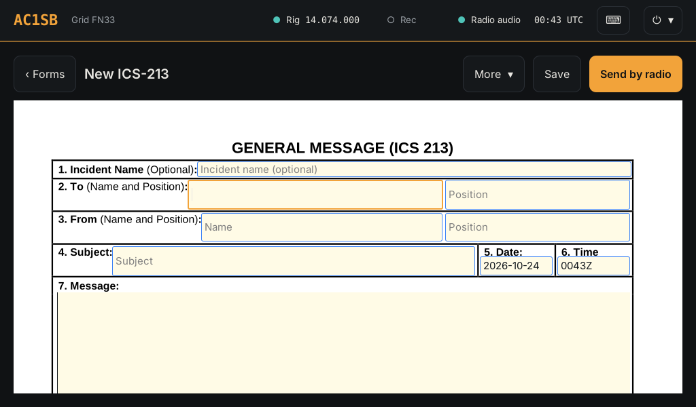

## Send a Winlink email

Winlink sends email over the radio through a gateway station. On HF, use VARA HF:

1. Open the **Email** folder and tap **VARA HF**. Wait for its window to open.
2. Go back Home (**⌂ Home** in the bar at the top) and tap **Email > Winlink mail**.
3. Start a new message (Pat's compose button), write it and send it. It waits in
   Pat's **Outbox** until you connect.
4. Tap **Connect**, pick **VARA HF** and a gateway (Reference > **Nearest Winlink
   gateways** lists the closest; within about 300 miles, pick one on 80 m or 40 m).
   The radio moves to the gateway's frequency and the message goes out. Any mail
   waiting for you comes in.

The rule: **open the modem (VARA HF) first, then Winlink mail.**

## Five rules

1. **One app transmits at a time.** There's one radio.
2. **Everything is in UTC.** Forms, logs and recordings all use it.
3. **Identify** as you would on voice. The digital apps send your callsign; on
   voice, you do.
4. **Esc (or ⌂ Home) always gets you back** to the Home screen. Nothing is lost:
   open apps stay open in the bar at the top.
5. **Don't change Settings** unless you're asked to. The station is already set up
   for its radio.

## Shut down

Tap **⏻ ▾** (top right) > **Power…** > **Shut down**. Close the apps first so they
save their settings. Turn the radio off after the station.

> **Desktop mode:** **⏻ ▾ > Power… > Exit Emcomm-CNC** leaves Emcomm-CNC and gives
> your computer its own speaker and microphone back.

---

# Part 2: Operating the station

## The station at a glance

### The screen

- **Top bar:** callsign, grid square (from the GPS when one is plugged in, or
  **Mesh** from a Meshtastic radio's GPS, see [Position from a Meshtastic
  radio](#position-from-a-meshtastic-radio)), local time and UTC, network status,
  weather alerts in force, **Rec**, the speaker and microphone icons (sound levels,
  see [Levels](#levels)), ⌨ (on-screen keyboard) and **⏻** (Settings, Diagnostics,
  Power).
- **Home:** the app tiles, 18 to a page. Swipe sideways, tap ◀ ▶ or press Page
  Up/Down for the next page.
- **Folders** group related apps under one tile. Standard folders:
  - **Email:** Winlink mail (Pat), VARA HF, VARA FM, ARDOP, Packet.
  - **Mesh & APRS:** Meshtastic, MeshCore, Mesh text, MC text, APRS.
- **Home bar:** when an app is open, a thin bar across the top of the screen has
  **⌂ Home**, a button for each open app (tap it to bring that app to the front,
  ✕ to close it), **Rec**, the speaker and microphone icons and the time. So levels
  can be changed while WSJT-X or VARA is on the screen.

Tapping a tile whose app is already open brings it to the front; it does not start
a second copy. While an app starts, its tile shows **Opening…**. If it shows
**Didn't start** or **No window yet**, see [Troubleshooting](#troubleshooting).

### Keys (when a keyboard is plugged in)

| Key | Goes to |
| --- | --- |
| Esc or F1 | Home |
| F2 | Diagnostics |
| F3 | Settings |
| F4 | Logs |
| F5 | Reference |
| F6 | Wi-Fi |
| F7 | Online |
| F8 | Net control |
| F9 | Forms |
| 1-9 | Open the first nine tiles on the page shown |
| Ctrl+Alt+T | Terminal |
| Alt+Tab | Switch between open apps |
| Volume up, down and mute keys | The listening speaker only, never the radio (on a dedicated station and in the Emcomm-CNC session) |

Every drop-down list can be searched: tap it and type, or start typing on it.

### Tile menu

Long-press a tile (or right-click it) for **Rename**, **Change picture**, **Move to a
folder** / **Take it out** and **Arrange tiles**.

### Dedicated station or desktop mode

The station runs two ways:

- **Dedicated station:** its own computer, starting straight into the Emcomm-CNC
  screen.
- **Desktop mode:** Emcomm-CNC added to an Ubuntu or Debian computer you already
  use, opened from the app menu or picked as the **Emcomm-CNC** session on the
  login screen.

Operating is the same in both. Where desktop mode differs, this guide says so in a
box like this:

> **Desktop mode:** differences show here.

The biggest difference is sound: see [Sound](#sound-one-card-for-the-radio-one-speaker-for-listening).

---

## Before you operate: the start-up check

Do this at the start of every session. It takes two minutes and catches almost
every problem before you go on the air.

1. **Radio on, then station.** Turn the radio on and connect its USB cable before
   starting the station (or before opening Emcomm-CNC in desktop mode). Rig
   control starts by itself once the radio is plugged in.
2. **Rig control.** The top bar shows **● Rig** and the radio's frequency. For a
   fuller check, **Settings > Radio > Test CAT** reads the frequency and mode back
   from the radio. If it fails, see [Troubleshooting](#troubleshooting).
3. **Time.** Check UTC in the top bar against a known source. FT8, JS8Call and VARA
   all fail if the clock is off by more than about a second. With a GPS plugged
   in, Diagnostics shows whether the clock is following it. A Meshtastic radio's
   GPS gives position only, never the time.
4. **Settings (F3) > Audio.** The **Radio sound card** section should name the
   radio's card (on the FT-710, the C-Media **USB Audio Device**). The **Listening
   speaker** should be the speaker or headphones you want to hear the Scanner and
   recordings on.
5. **Settings > Radio > Test PTT** (or Diagnostics > PTT test) into a dummy load,
   or on a clear frequency after identifying. It asks first, then keys the radio
   for two seconds.

You're ready to operate.

---

## How the pieces fit together

### One radio, one rig control

All the radio apps reach the radio through one program, **rigctld** (Hamlib's rig
control server, at `127.0.0.1:4532`). It owns the radio's CAT port and keys the
radio. That's why the radio is set up once, in **Settings > Radio**, and every app
is pointed at the same place:

| In the app, choose | Value |
| --- | --- |
| Rig / radio | **Hamlib NET rigctl** |
| Address / network server / device | **127.0.0.1:4532** (fldigi writes it `localhost:4532`) |
| PTT method | **CAT** (fldigi: "PTT via Hamlib command") |

Don't pick the radio's own model (FT-710, FT-891) inside an app, and don't pick
**FLRig**: the station doesn't run flrig, and only one program can hold the CAT
port. rigctld handles the radio model and PTT method chosen in Settings.

### Letting the station set up the apps

**Settings > Radio** has a box: **Let Emcomm-CNC set up WSJT-X, JS8Call, fldigi,
QSSTV, Pat and Xastir for this radio**. It's off until you tick it (it explains what it changes
and asks first). With it ticked, Emcomm-CNC writes the settings in the table above,
plus the mode for digital apps, split, your callsign and grid, into each of those
apps: when you tap **Save and use this radio**, when Emcomm-CNC starts, and each time
the app is opened from its tile. Nothing else in the apps is changed, and sound
cards are left alone (the station moves radio apps onto the radio's sound card while
it runs).

- An app has to be **closed** to be changed: an open app writes its own settings back
  when it closes. Save says which apps it skipped.
- **Apps…** next to the box leaves single apps alone.
- The old settings file is kept in `~/.local/state/emcomm/config-backups`.
- With the box unticked, Emcomm-CNC changes nothing in those apps. Set each one as in
  its chapter below.

So with the box ticked, the per-app settings tables in this guide are a **check**,
not a job: open the settings once and confirm they match.

**Transmit from one app at a time.** There is one radio. Any app can key it and
change its frequency, so two transmitting apps will fight.

### Sound: one card for the radio, one speaker for listening

The station keeps two kinds of sound apart:

- **Radio apps** send and receive audio through the radio's sound card: WSJT-X,
  JS8Call, fldigi (and flamp), QSSTV, VARA HF and VARA FM, ARDOP, Direwolf (Packet
  and APRS).
- **Everything else** plays on the **Listening speaker** (Settings > Audio): the
  Scanner, Gqrx, the browser, the Library, recordings, alert sounds. If there's no
  listening speaker, they play into a silent output. Nothing that isn't a radio app
  is ever let onto the radio's sound card, so it can't be transmitted by VOX or
  mixed into a digital signal.

While Emcomm-CNC is running, the radio apps reach the radio's sound card with no
sound settings of their own: the station moves each one onto the radio as it
starts. Leave their audio device on **default** (or **pulse**). If the radio is
unplugged, their sound goes to a silent output rather than to a speaker.

> **Desktop mode:** this holds whenever Emcomm-CNC is open, whatever Settings >
> Audio > **When the radio is every app's speaker and microphone** is set to. That
> setting only matters for radio apps you run **with Emcomm-CNC closed**:
>
> - **Only while Emcomm-CNC is open** (recommended): the radio is the default only
>   while Emcomm-CNC is open; your own speaker and microphone come back when you
>   exit.
> - **Always:** the radio is always the default.
> - **Never:** your computer's own speaker stays the default. A radio app used with
>   Emcomm-CNC closed must be set to the radio's sound card by name (on the FT-710,
>   the C-Media **USB Audio Device**). "default" or "pipewire" would then lead to the
>   computer's speaker: you hear the tones and nothing goes out.
>
> An app left set to a *different* USB sound card is left alone, since that may be a
> second radio.

### Levels

**Settings > Audio > Levels** has two sliders with live meters:

- **To radio** (transmit audio from the radio apps). This one level is shared by
  every radio app, so set it once (about 40–60%) and trim each app with its own
  control (VARA's Drive level, WSJT-X's Pwr slider). Aim for the radio's ALC at about
  a third of its scale or less; higher ALC distorts the signal and splatters. The
  slider isn't linear, so take big steps.
- **From radio** (receive audio into the radio apps). Set it so the meter sits about
  a third of the way up on band noise.

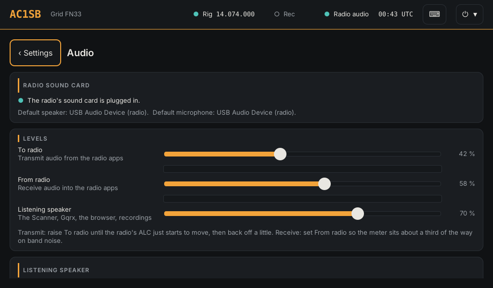

Set them once per radio and band; they're kept. **Diagnostics > Audio levels** opens
the same page.

**From any screen:** the top bar (and the Home bar over other apps) has a speaker
icon and a microphone icon. Tap one and its sliders drop down; tap anywhere else to
put them away. They're the same levels as Settings > Audio: move one and the other
moves too.

- **Speaker icon:** the **Listening speaker** volume, with a mute button, and which
  speaker it's playing on. The icon shows the volume, or a crossed-out speaker when
  it's muted or there's no listening speaker. To pick a different speaker, tap
  **Audio settings**.
- **Microphone icon:** the radio's **To radio** and **From radio** levels, with the
  meters. Tune or transmit and watch the radio's ALC while you move **To radio**.

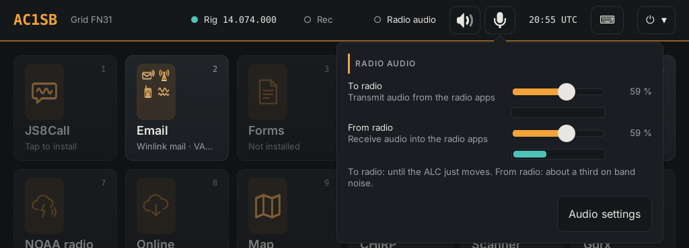

The keyboard's volume keys change the listening speaker too, never the radio: on a
station the radio is the default speaker, so the usual volume keys would change the
transmit level. (In desktop mode with Emcomm-CNC in a window, your desktop's own
volume keys and menu still work as before; while the radio is the default speaker,
its volume there is **To radio**.)

### The modem ports

The Winlink modems and Direwolf each listen on a local port that Pat or Xastir
connects to. Only programs on the station itself can reach them (the firewall
blocks the network).

| Program | Port | Used by |
| --- | --- | --- |
| rigctld | 4532 | every radio app |
| VARA HF / VARA FM | 8300 | Pat |
| ARDOP (ardopcf) | 8515 | Pat |
| Direwolf, main radio | 8000 (AGW), 8001 (KISS) | Pat (packet), Xastir |
| Direwolf, APRS radio | 8010 | Xastir, iGate |
| Pat | 8080 | the Winlink mail window |

VARA HF and VARA FM share port 8300, so only one of them can run at a time.

---

## Which apps work together, and in what order

### Order to open things

| To do this | Open first | Then | Notes |
| --- | --- | --- | --- |
| Winlink over VARA HF | **VARA HF** (wait for its window) | **Winlink mail** | Pat tunes the radio and keys it through VARA |
| Winlink over VARA FM | **VARA FM** | **Winlink mail** | Needs a VHF/UHF radio as the main radio |
| Winlink over ARDOP | **ARDOP** | **Winlink mail** | |
| Winlink over packet | **Packet** | **Winlink mail** | 1200 baud, VHF/UHF |
| FT8 | **WSJT-X** | | |
| JS8 | **JS8Call** | | |
| PSK, MT63, Olivia, etc. | **fldigi** | **flamp** or **flmsg** if needed | |
| Send or receive a picture (SSTV) | **SSTV** | | |
| Send an ICS-213 by radio | **Forms** (F9) | it offers **Start fldigi** | |
| APRS | **APRS** | | Starts Direwolf and Xastir together |
| Listen on a scanner | **Scanner** or **Gqrx** | | Uses an SDR dongle, not the radio |

The rule for Winlink: **modem first, then Pat.** Pat connects to the modem when you
tap Connect; if the modem isn't running, the connect fails.

### Can run at the same time

- **Any radio app + Scanner, Gqrx, NOAA radio, ADS-B map.** These use RTL-SDR
  dongles, not the radio.
- **Any radio app + Recorder.** The Recorder records the radio's receive audio
  alongside whatever else is listening.
- **Any radio app + Forms, Logs, Reference, Map, Online, Library.**
- **Several radio apps listening** (JS8Call and fldigi, say) all hear the radio.
  Transmit from only one.
- **APRS on the APRS radio + anything on the main radio.** With a second radio set up
  in Settings > APRS iGate, APRS has its own radio and sound card.
- **Meshtastic and MeshCore** use their own LoRa radios.
- **An app on radio 1 + an app on radio 2** ([Two radios at once](#two-radios-at-once-radio-1-and-radio-2)),
  for example JS8Call on the FT-710 while Packet or VARA FM runs on a VHF radio.
  Each transmits on its own radio.

### Don't run together

- **Two modems for Pat at once** (VARA HF and VARA FM can't both start; VARA and
  ARDOP would both hear and answer).
- **Two apps that control the same radio's frequency**, such as WSJT-X and JS8Call:
  each moves the radio to its own frequency. Close one before opening the other, or
  put one on radio 2.
- **Packet and APRS on the main radio** when there's no APRS radio: they share one
  Direwolf on one frequency.
- **Scanner and Gqrx on the same dongle.** Each SDR dongle serves one program. With
  two dongles plugged in, each takes its own.

---

## Winlink email: Pat with VARA, ARDOP or packet

**Winlink mail** (Pat) is the station's email client for the Winlink system. It
opens in its own window. Pat doesn't make sound itself; it hands each message to a
**modem** (VARA HF, VARA FM, ARDOP or Packet), which talks to the radio.

| Modem | Band | Speed | Notes |
| --- | --- | --- | --- |
| VARA HF | HF | Fastest on HF | Windows program, runs under Wine. Speed-limited without a licence key |
| ARDOP | HF | Slower than VARA | Free, open source |
| VARA FM | VHF/UHF | Fast | Needs a VHF/UHF radio |
| Packet | VHF/UHF | 1200 baud | Uses Direwolf; works with any FM radio |

### First-time setup (once)

1. Open **Winlink mail**. With the Settings > Radio box ticked
   ([Letting the station set up the apps](#letting-the-station-set-up-the-apps)), Pat
   already has your callsign, grid and the rig control address; otherwise, enter your
   callsign and grid in Pat's configuration page too.
2. Open Pat's configuration page and enter your **Winlink password**.

### Sending and receiving over VARA HF

⚠ **Not yet tested on this station.**

1. Tap **VARA HF** (Email folder). The first time, it installs VARA from a setup
   `.zip` in Downloads or on a USB stick; if there's none, it opens Winlink's
   download page.
2. Wait for the VARA HF window.
3. Tap **Winlink mail**.
4. Write your message with **New message**, or skip this to just check mail.
5. Tap **Connect**. Pick **VARA HF**, the gateway's callsign, and its frequency
   (the gateway finder on the Reference page lists the nearest ones). Pat sets the
   radio to the gateway's dial frequency and connects.
6. Watch the VARA window: the waterfall, the signal-to-noise figure and the
   transfer. When it disconnects, received mail is in Pat's inbox. Attachments
   (PDFs, photos, Word and Excel files) open on the **Files** page.

**VARA HF settings** (VARA's own Settings menu, once):

| Setting | Value |
| --- | --- |
| SoundCard > Device Input / Output | The default device. The station moves VARA onto the radio |
| PTT | **None**. Pat keys the radio through rig control |
| TCP ports | 8300 (the standard; Pat expects it) |
| Licence key | Your key, if you have one |

On the radio, turn **VOX off**. Set the levels as in [Levels](#levels), and use VARA's
own **Tune** button to check the ALC. Tune only works while a mail program is linked
to VARA: in Pat, tick **Listen > varahf** first (untick it afterwards, because while
it's on VARA can answer incoming calls and transmit), or set the level during a real
connection.

Tested on an FT-710 in USB mode, connected by its own USB cable: To radio **59%**,
VARA Drive level **−11 dB**, which gives ALC at about 3 on Tune.

### VARA FM

⚠ **Not yet tested on this station.**

The same as VARA HF, with **VARA FM** in place of VARA HF and an FM gateway on a
VHF/UHF frequency. The FT-710 and FT-891 reach 6 m but not 2 m or 70 cm, so VARA FM
needs a VHF/UHF radio set as the main radio in Settings > Radio.

### ARDOP

1. Tap **ARDOP** (Email folder). A window opens with the modem's log; leave it open.
2. Tap **Winlink mail** > **Connect** > **ARDOP**, the gateway and its frequency.

ARDOP needs no settings: it uses the radio's sound card and Pat keys the radio.

### Packet

1. Tune the radio to the packet gateway's frequency (FM).
2. Tap **Packet** (Email folder). Direwolf opens in a window and shows each packet
   it hears.
3. Tap **Winlink mail** > **Connect** > **AX.25** (packet) and the gateway's
   callsign.

Direwolf's settings are written each time Packet starts (1200 baud, PTT through rig
control). For your own settings, copy `~/.config/emcomm/direwolf.conf` to
`~/.config/emcomm/direwolf.custom.conf` and edit that.

### When it doesn't connect

- The modem window isn't open, or was opened after Pat tried: open the modem, then
  Connect again.
- No transmit: check **Diagnostics > PTT test**, and that VARA's PTT is set to None
  (Pat keys the radio).
- Transmits but the gateway doesn't answer: check the clock, the To radio level
  (ALC), and that you're on the dial frequency Pat set.
- The gateway list is old: **Reference > Nearest Winlink gateways > Update list**
  (needs the internet).

---

## WSJT-X (FT8)

**What it's for:** FT8 and the other weak-signal modes. At an emcomm station it's
mostly a band check: which bands are open, and from where (the map shows stations
heard, and Online > Who heard me shows who heard you).

Tap **WSJT-X**. With the Settings > Radio box ticked
([Letting the station set up the apps](#letting-the-station-set-up-the-apps)), your
callsign, grid and the Radio tab below are filled in each time it's opened from the
tile. Open it from the tile, not from the computer's own app menu, or they aren't.

### Settings (File > Settings): set once, or check

**Radio tab**

| Setting | Value |
| --- | --- |
| Rig | **Hamlib NET rigctl** |
| Network Server | **127.0.0.1:4532** |
| PTT Method | **CAT** |
| Mode | **Data/Pkt** |
| Split Operation | **Fake It** |

Tap **Test CAT** (turns green) and **Test PTT** (keys the radio).

**Audio tab**

| Setting | Value |
| --- | --- |
| Input | **default** (the station moves it to the radio). Used with Emcomm-CNC closed in desktop mode set to Never: the radio's **USB Audio Device** |
| Output | The same as Input |
| Channels | **Mono** |

Leave the Power slider (bottom right of the main window) near the top and set the
transmit level with **To radio** in Settings > Audio.

### Operating

Pick the band from the drop-down; WSJT-X moves the radio there. Contacts logged in
WSJT-X show on the station's Logs page.

---

## JS8Call

**What it's for:** keyboard messaging on HF that gets through in poor conditions,
with store-and-forward through other stations (relay and inbox). Good for passing
short traffic when voice isn't working.

Tap **JS8Call**. As with WSJT-X, the Settings > Radio box fills in your callsign,
grid and the Radio tab each time it's opened from the tile.

### Settings (File > Settings): set once, or check

**Radio tab:** the same as WSJT-X: Rig **Hamlib NET rigctl**, Network Server
**127.0.0.1:4532**, PTT **CAT**, Mode **Data/Pkt**, Split **Fake It**.

**Audio tab:** the same as WSJT-X: **default**, **Mono**.

JS8Call's messages and activity show on the Logs page. Frequencies for JS8 on each
band are in Reference.

---

## fldigi, flamp and flmsg

### fldigi

**What it's for:** the general digital-mode program: PSK, MT63, Olivia, RTTY, CW and
the NBEMS modes used to pass ICS forms. Forms' **Send by radio** uses fldigi.

With the Settings > Radio box ticked, the station fills in your callsign and the
rig control below each time fldigi is opened from its tile, and puts the radio in the
profile's mode for digital apps (DATA-U or USB). Otherwise, set these once. The Audio
setting is yours either way.

**Configure > Rig Control > Hamlib**

| Setting | Value |
| --- | --- |
| Use Hamlib | ticked |
| Rig | **Hamlib NET rigctl** |
| Device | **localhost:4532** |
| PTT via Hamlib command | ticked |

Untick **Use flrig** and **Use RigCAT** if either is ticked. Tap **Initialize**.

**Configure > Audio > Devices**

| Setting | Value |
| --- | --- |
| With Emcomm-CNC open | **PulseAudio** (server string left blank) |
| Used with Emcomm-CNC closed, desktop mode set to Never | **PortAudio**, Capture and Playback: the radio's **USB Audio Device** |

Save the configuration before closing the dialog.

### flamp

Sends files (a spreadsheet, a picture, a long message) as blocks that the other
station can re-request if any are missed. It works through fldigi: open **fldigi**
first, then flamp from fldigi's menu.

### flmsg

Fills in and reads NBEMS forms (ICS-213 and many others). Most of the time use the
station's own **Forms** page instead (next section), which shows ICS-213s on FEMA's
form and sends them through fldigi. Use the **flmsg** tile for its other forms. The
station keeps flmsg on UTC (dates `2026-10-21`, times `1356Z`) and in its full
window.

---

## SSTV: pictures over the air (QSSTV)

**What it's for:** sending a picture by radio with no internet: a photo of damage, a
map with markings, a filled-in paper form. Tap **SSTV**; the first tap offers to
install it.

- **Receive:** QSSTV listens all the time it's open and decodes any picture it
  hears (Mode **Auto**). Pictures are saved in `~/qsstv/rx_sstv` and shown under
  **Gallery**.
- **Send:** **Transmit** tab, open the picture, pick the mode, then the transmit
  button. Agree the mode with the other station first. **Robot 36** (36 s) or
  **Martin 1** (about 2 min) are common; slower modes give a cleaner picture on a
  weak signal.
- **Where:** 14.230 MHz USB is the usual HF SSTV calling frequency; on VHF/UHF use
  the frequency your group agrees, on FM.

With the Settings > Radio box ticked, the station fills in your callsign, locator and
the rig control below each time QSSTV is opened from its tile, and puts the radio in
the profile's mode for digital apps (DATA-U or USB). Otherwise, set these once.

**Options > Configuration > Cat interface**

| Setting | Value |
| --- | --- |
| Enable Hamlib Cat Interface | ticked |
| Radio Model | **2 Hamlib, NET rigctl** |
| Serial Port/Host | **127.0.0.1:4532** |
| PTT Control via | **CAT (Data port)** (on a radio with no PTT, the station turns on QSSTV's VOX instead) |

**Options > Configuration > Sound:** **PulseAudio** (the default). The station moves QSSTV onto the
radio's sound card.

⚠ **QSSTV not yet tested on this station's radios.**

---

## Forms: ICS-213 messages, nets, ICS-309 and ICS-205

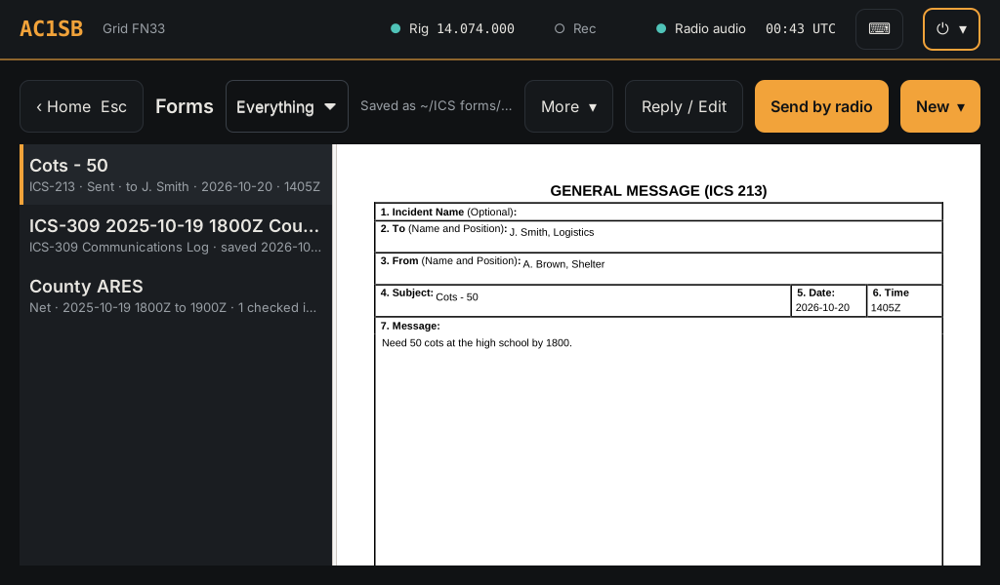

**Forms** (tile or F9) is one page for everything written down during an event. The
list on the left holds every ICS-213 message (written here or received by fldigi),
every net, and every ICS-309 and ICS-205, newest first. The drop-down narrows it to
one kind. Pick one to see it on the right.

### Write an ICS-213

1. **New ▾ > ICS-213 message.** The blank FEMA form opens with a box on each field.
2. Fill in To, From, Subject and Message. The date and time (UTC) are already
   filled in, and the incident too while a net is open.
3. **Save**, or **Send by radio** to send it now.

### Reply to an ICS-213

Pick the message in the list and tap **Reply / Edit**. A received message gets the
reply boxes at the bottom and is saved as a copy, so what came in stays as it was.

### Send by radio

1. Pick the message (or tap Send by radio while writing one; it saves first).
2. The window shows whether fldigi is running. If not, tap **Start fldigi** and wait.
3. Pick the modem (MT63-2000L is the usual choice; agree it with the receiving
   station). The one fldigi is on is picked already.
4. Tap Send. fldigi keys the radio and sends; the window says when it's back on
   receive.

The other station's fldigi saves the message for flmsg as usual, and it shows on
their Forms page. A copy of what went out is kept in `~/.nbems/WRAP/send`.

### Receive an ICS-213

Leave **fldigi** open on the agreed frequency and mode. Received messages appear in
the Forms list. Tap one to see it on FEMA's form; **More ▾ > Print** prints it or
saves a PDF.

### Run a net

1. **New ▾ > Net log** (or F8). Name the net and tap **Start net**.
2. Check-ins: type the callsign and press Enter (or tap **Check in**). As you type,
   the line above shows the name, town, licence class and DMR ID from the offline
   lists (see [Offline callsign and DMR ID lookup](#offline-callsign-and-dmr-id-lookup)).
   An expired licence shows in red; a US call the FCC list doesn't have is noted,
   usually a miscopied call. The check-in is logged with the name and town, which
   also print on the ICS-309.
3. Traffic: fill in From, To and Message and tap **Log**.
4. **Undo** removes the last entry.
5. When you're done, **Close net**.

Every entry gets the UTC time. The open net stays at the top of the Forms list with
**Net control** and **ICS-309 log** buttons.

### ICS-309 and ICS-205

- **ICS-309 Communications Log:** pick a net in the list and **New ▾ > ICS-309 Communications Log** (or **ICS-309 log** on Net control). It
  fills in the log from that net (or the open or last net).
- **ICS-205 Radio Communications Plan:** filled in from My frequencies (receive and
  transmit frequency, tone, and the note as the assignment).

Both are saved in `~/ICS forms` and open with a **Print** button; the print dialog
can also save a PDF to a USB stick.

---

## Files: Winlink attachments and downloads

**Files** (tile) shows the files that come to the station, newest first:

- **Winlink attachments:** every file attached to a message in Pat's mailbox (in,
  out, sent and archive), read straight from the mailbox: nothing to download first.
  Each one is listed with its sender and subject.
- **Downloads:** files saved to `~/Downloads`, such as a file opened from Pat's
  window or the Browser.
- **SSTV pictures:** pictures QSSTV has received.

Tap a file to see it. The list on the left has a search box (name, sender or
subject) and a menu to show one kind only.

| File | Shown as |
| --- | --- |
| PDF | The pages, one under the other |
| Photos and pictures (JPEG, PNG, GIF…) | The picture, fitted to the screen |
| Word, Excel, PowerPoint, OpenDocument, RTF | The pages, made by LibreOffice |
| Text, CSV, KML, GPX | The text |

- **Print** prints a PDF, an office file or a picture. The print dialog can also save
  a PDF, for a USB stick.
- **Edit in LibreOffice** opens a Word, Excel or text file to change it. A Winlink
  attachment is saved in `~/Winlink attachments`, one folder per message, so a
  filled-in spreadsheet can be attached to a reply from there.
- **LibreOffice** is installed the first time an office file is opened (about 300 MB,
  needs the internet once); the page offers it.

---

## Logs

**Logs** (tile or F4) shows in one place:

- **Contact notes:** your own notes. Type a callsign and a note (traffic passed,
  signal report, net) and tap **Add note**; the UTC time, frequency and mode are
  filled in from the radio. As you type the callsign, its name, town, licence
  class and DMR ID show from the offline lists, and the note is saved with the
  name and town.
- **JS8Call messages** and **JS8Call all activity.**
- **WSJT-X contacts.**
- **Winlink mail.**
- **Station updates:** the log of the last Update station, with each slow step's
  time and the slowest steps at the end.
- **Callsign list downloads:** how the last background download of the FCC and DMR
  ID lists went.

The **Forms** button goes to Forms (F9) and **Recorder** to the Recorder.
**Look up** opens the callsign and DMR ID search below.

### Offline callsign and DMR ID lookup

The station keeps two lists, so lookups work with no internet:

| List | From | Covers | Where it's kept |
| --- | --- | --- | --- |
| FCC amateur licences | FCC ULS weekly file (`l_amat.zip`, roughly 150 MB to download) | US calls: name, town, state, licence class, active or expired | `/var/lib/emcomm/callsigns.db` |
| DMR IDs | RadioID.net `user.csv` (roughly 20 MB) | Every registered DMR user worldwide: ID, call, name, city, state, country | `/var/lib/emcomm/dmrids.db` |

- **Getting them:** run **Update station** once with the internet connected. After
  that, each Update station downloads a list again only when the copy is over a week
  old. The download (about 170 MB for both) and the rebuild run **in the
  background** after the update says so, taking a few minutes; lookups use the old
  list until the new one is ready. Logs > **Callsign list downloads** shows how it
  went. Offline, the last lists are kept and keep working, and the next Update
  station with internet tries again.
- **Look up** (Logs page): type a callsign or a DMR ID. Matches list as you type:
  calls that start with what you typed, or IDs that start with the digits. Tap one to
  put the call in the contact note. The line under the box says how old the FCC list
  is.
- **In Net control and contact notes**, the line under the callsign shows the same
  details. Calls outside the US show from the DMR list when the operator has a DMR ID.
- From a terminal: `emcomm-callsign lookup W1AW 3112345` prints both lists' entries.

---

## Recorder and Broadcastify

### Recorder

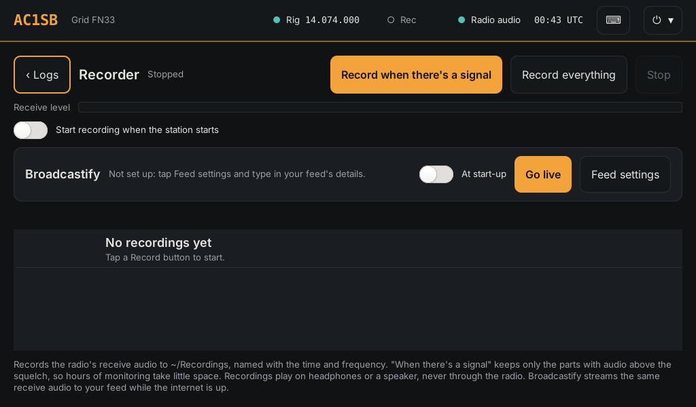

Records the radio's receive audio to `~/Recordings`, each file named with the UTC
time, frequency and mode. Open it with **Rec** in the top bar.

- **Record when there's a signal:** keeps only the parts with audio. Use it to
  monitor a frequency for hours.
- **Record everything:** continuous, in hourly files.
- **Stop** ends it. **Start recording when the station starts** brings it back
  after a restart or power cut.

**Rec** turns red while recording. Recordings play on the Listening speaker, never
through the radio. **Select**, then tap recordings (or **Select all**), then
**Delete** removes several at once. When `~/Recordings` passes about 2 GB, the oldest
recordings are deleted to make room.

### Broadcastify

Streams the same receive audio to a Broadcastify feed. Apply for a feed at
broadcastify.com; once it's approved, type its server, port, mount and password in
**Feed settings** and tap **Go live**. **Live** shows next to Rec while it streams. It
reconnects by itself if the internet drops.

⚠ **Not yet tested on this station** against Broadcastify's own servers.

---

## Reference and the Winlink gateway finder

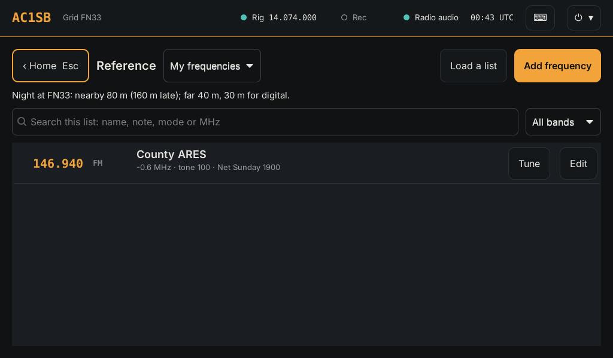

**Reference** (tile or F5) holds the frequency lists:

- US band plan, with a line at the top saying whether it's day or night at your
  grid and which HF bands to try for nearby and distant stations.
- Emergency and calling frequencies (IARU emergency centres of activity, Hurricane
  Watch Net, SATERN, 60 m channels, simplex calling, APRS).
- JS8Call and FT8 dial frequencies.
- Other services to listen to (NOAA Weather Radio, marine channel 16, aviation
  guard, FRS/GMRS, MURS, CB), marked receive only.
- **My frequencies:** your own list.

The row the radio is on is highlighted. The search box narrows by name, note, mode
or MHz; the drop-down by band.

- **Tune** puts the radio on that frequency and mode. For a repeater in My
  frequencies, it also sets the offset and tone (on bands the radio supports).
- **Save to mine** copies a row to My frequencies.
- **Add frequency** saves the radio's current frequency (or one you type) with a
  name and note. **Edit** changes or removes one of your rows.
- **Load a list** adds a CSV from a USB stick or Downloads: the station's own
  layout, a CHIRP export, or a RepeaterBook or RadioReference download.

### Nearest Winlink gateways

On the Reference page: every gateway channel from Pat's list, nearest to your grid
first, with distance, bearing, mode, hours and whether it's open now. Pick VARA HF,
ARDOP, VARA FM or Packet to narrow it, and **Tune** puts the radio on the gateway's
dial frequency. **Update list** downloads a fresh one when the station is online.

Within about 300 miles, NVIS on 80 m or 40 m (or 60 m) usually works better than
the nearest gateway on a higher band.

---

## Scanner

The Scanner is the station's own scanning receiver. It uses an **RTL-SDR dongle**
(or another SDR), not the radio, so it runs alongside anything else, and it plays on
the Listening speaker.

### Start

Plug in a dongle with a VHF/UHF antenna and tap **Scanner**. It scans
`~/Scanner channels.csv`, which starts as Vermont's emergency channels (law
enforcement, fire/EMS, interop/EOC) plus an **Airband** group.

### Controls

| Control | What it does |
| --- | --- |
| Groups (left) | Tick or untick whole groups |
| Distance | Listen within 10, 25, 50 or 100 miles of your grid, or everywhere. Statewide channels with no site are always kept |
| **Hold** | Stay on the channel. Tapping a channel in the list also holds there |
| **Skip** | Move on |
| **Lock out** | Leave this channel out of the scan (or untick it) |
| **Stay on a signal** | How long it listens once it stops: until quiet plus 2, 5 or 10 s for a reply, or a set time (5 s to 1 minute) |
| **Tone squelch** | Stop only when the channel's own PL tone is there. DPL channels stop on any signal |
| Squelch | 1 opens on almost anything, 9 needs a strong signal; 4 suits most antennas |
| **Tune** | Keypad to listen on any frequency the receiver reaches; − and + step 12.5 kHz (5 kHz below 50 MHz) |
| **Save to list** | Adds the tuned frequency to **My channels** |
| **Load a list** | Any CSV with a Frequency column (MHz), such as a RadioReference export, from a USB stick |
| **Receiver** | Which SDR, gain and frequency correction (ppm) |

It plays analog FM and AM. P25, DMR and other digital channels are listed but not
scanned. Airband needs an antenna for about 120-135 MHz: a 2 m/70 cm antenna hears
nearby aircraft; a discone or an airband quarter-wave (about 58 cm) does better.

### Dongles

Each dongle serves one program. With three dongles, a sensible split is:

| Dongle | Used by |
| --- | --- |
| 1 | NOAA radio (weather alerts), 162 MHz antenna |
| 2 | Scanner or Gqrx, VHF/UHF antenna |
| 3 | ADS-B (map aircraft), 1090 MHz antenna, picked in Settings > Devices > ADS-B receiver |

With only one dongle, the weather alert listener pauses while the Scanner or Gqrx
has it, and resumes when they close. **Settings > Devices > Free the SDR receiver**
closes whatever is holding a dongle.

---

## Gqrx

A waterfall receiver for listening anywhere a receiver reaches, HF included. Modes:
FM, AM, SSB, CW. The Scanner's channel list is loaded as its bookmarks.

- Tap **Gqrx**. With more than one receiver it asks which. Press Gqrx's **▶** to
  start receiving.
- **HF on an RTL-SDR:** an RTL-SDR Blog V4 tunes HF directly. Other RTL-SDR dongles
  offer "on HF (direct sampling)" for 0.5 to 28.8 MHz.
- **No receiver plugged in:** **Practice signal** plays a recording around 146.5 MHz
  to learn on; **Network receiver** uses an RTL-SDR on another computer (`rtl_tcp`).

Gqrx is receive only and never touches the radio.

---

## NOAA radio (weather alerts with no internet)

Decodes the SAME alert bursts from NOAA Weather Radio with an RTL-SDR dongle and a
162 MHz antenna.

1. Tap **NOAA radio**.
2. Pick your nearest transmitter's channel (weather.gov/nwr lists them).
3. Pick a state and county and tap **Add county**, for each county you want.

Alerts for your counties join the internet alerts in the top bar and on the Online
page; warnings pop up on screen. The weekly test is noted but not shown as an alert,
so you can see the receiver is working.

---

## APRS and the iGate

### APRS tile

Tap **APRS** (Mesh & APRS folder). It starts Direwolf and opens **Xastir**. Direwolf
stops when Xastir closes.

With the Settings > Radio box ticked
([Letting the station set up the apps](#letting-the-station-set-up-the-apps)),
Xastir gets your callsign, the position at the centre of your grid square, and its
radio connection. Otherwise set them once in Xastir:

| Xastir menu | Setting |
| --- | --- |
| File > Configure > Station | Callsign, latitude and longitude |
| Interface > Interface Control > Add | **Networked AGWPE**, host **localhost**, port **8000** (main radio) or **8010** (APRS radio), transmit enabled, activate on startup |

- With no APRS radio set up, APRS uses the main radio, which must be on 144.390 MHz
  FM (North America), and the FT-710 and FT-891 can't reach it.
- With an APRS radio set up (below), it uses that radio.

### APRS radio and iGate (Settings > APRS iGate)

⚠ **Not yet tested on this station.**

A second radio kept on 144.390 MHz, with its own Digirig. For the Icom ID-5100: a
Digirig Mobile and Digirig's "ICOM RJ-45 Cable for Digirig Mobile", in the mic jack
and SP1. Unplug the hand mic while it's in use.

| Setting | Value |
| --- | --- |
| Sound card | The Digirig, listed by USB socket. Keep it in the same socket |
| PTT port | The Digirig's serial port |
| iGate | **Off** (APRS tile only), **Receive only** (passes what it hears to the internet, never transmits), or **Two-way** (also sends messages from the internet to nearby stations, and beacons every 30 minutes) |
| SSID | -10 unless you pick another |
| Position | Grid square centre, unless you type a latitude and longitude |

Start with **Receive only**, the ID-5100's VOX off and its volume fairly low. The
page shows the APRS-IS connection and how many packets were heard and passed.

---

## Meshtastic and MeshCore

LoRa text messaging on their own small radios, separate from the station's radio.
The Mesh & APRS folder has four mesh tiles:

- **Meshtastic:** Meshtastic's own app, the same one as on Android. Messages and
  channels, the node list with signal and battery, a map, traceroute, telemetry
  and every radio setting, all by touch.
- **MeshCore:** Meshy, a MeshCore app made for small touch screens. Messages,
  channels, contacts, a map with routes, and device and repeater settings.
- **Mesh text:** a plain text client for Meshtastic (`contact`). It also pairs
  Bluetooth radios.
- **MC text:** the MeshCore text client (`meshcore-cli`); type `?` for its
  commands. It also pairs Bluetooth radios.

### Meshtastic

1. The first tap offers to install it (about 1 GB from Flathub, a few minutes,
   needs the internet once). After that it works with no internet, and each
   **Update station** brings it up to date.
2. Plug the node in by USB and tap **Meshtastic**. It finds the node itself, or
   pick it under **Connect**. It reconnects to the same node next time.
3. **Bluetooth:** pair the radio once with **Mesh text** (below), then pick it in
   the app's Bluetooth list. The app can't enter a Bluetooth PIN itself yet.
4. **Wi-Fi:** a node on the same network can be reached by its address (port 4403).

The app's own map needs the internet. The station **Map** works offline and shows
the same nodes on its Mesh layer.

⚠ **Meshtastic app not yet tested on this station.**

### MeshCore

1. The first tap offers to install it (about 1 GB from Flathub, a few minutes,
   needs the internet once). After that it works with no internet, and each
   **Update station** brings it up to date.
2. Plug the node in by USB, or turn on its Bluetooth, and tap **MeshCore**. Pick
   the node in its connect list.
3. **Bluetooth:** if it asks for a PIN it can't take, pair the radio once with
   **MC text** (below), then pick it again in MeshCore.

The app's own map needs the internet for areas it hasn't shown before. The station
**Map** works offline and shows the same nodes on its Mesh layer.

⚠ **MeshCore app not yet tested on this station.**

### Mesh text and MC text

1. Plug the node in by USB, or turn on its Bluetooth.
2. Tap **Mesh text** or **MC text**.
3. With no USB node, it searches for Bluetooth radios for 10 seconds and asks which.
   The first time, it pairs and asks for the PIN: Meshtastic shows it on its screen
   (or uses 123456 on a node without one); MeshCore uses 123456 unless you changed
   it.

⚠ **Bluetooth pairing not yet tested on this station.**

A node takes one connection at a time, so open one mesh tile per node. While a
tile has the node, the Map's Mesh layer keeps the last list it had. The Mesh
layer asks the node **Mesh text** or **MC text** last used (or the Meshtastic radio
picked below for position), so open the text tile once if the layer stays empty.

### Position from a Meshtastic radio

A Meshtastic radio with a GPS (T-Beam, T-Echo, RAK with a GPS module, Wireless
Tracker and the like) can give the station its grid square when no USB GPS has a fix.

1. Plug the radio in by USB. Check its GPS is on (Meshtastic app > the radio's
   settings > Position > GPS mode **Enabled**) and it has a view of the sky.
2. **Settings > Devices > Position from a Meshtastic radio's GPS:** pick the radio's
   port, then **Save**. The radio's own port only: the radio's CAT and PTT ports and
   the USB GPS aren't offered, and are never opened.
3. The top bar shows **● Mesh FN33ld**. When it differs from the saved grid it says
   "tap to use"; tapping it (or **Settings > User > From GPS**) fills in the grid.
   Then **Save**.

How it works and its limits:

- The station asks the radio every 30 minutes, for a few seconds, and never while
  the **Meshtastic** or **Mesh text** tile is open (a radio takes one connection at
  a time). If you tap the Meshtastic tile in those few seconds and it can't connect,
  tap Connect again.
- A USB GPS with a fix always comes first. A fix more than 6 hours old isn't used.
- A position typed into the radio (fixed position) doesn't count: that's the grid you
  already typed.
- **Position only, not time.** Meshtastic gives the time in whole seconds, from a
  report sent whenever the radio gets round to it, with no timing pulse. At best the
  clock would be right to about a second, often worse. FT8 needs it within about half
  a second (WSJT-X stops decoding at 2 to 3 seconds out), so the clock is never set
  from the mesh radio. For time with no internet, plug in a USB GPS: any u-blox puck
  (VK-162 and the like, about $15 to $25) works with no setup and keeps the clock
  within about a tenth of a second, plenty for FT8.
- Top bar words when there's no position: **Mesh asking** (first answer still to
  come), **Mesh no fix yet**, **Mesh fix too old**, **Mesh no GPS** (the radio has
  none), **Mesh GPS off** (switched off in the radio), **Mesh radio busy** (a mesh
  tile has it). Nothing shows while the radio is unplugged.
- **Diagnostics > GPS** shows the radio's last position, when it was fixed and asked,
  and any error.

⚠ **Not yet tested with a real Meshtastic radio on this station.**

---

## Map

An offline map with grid squares, your station, Winlink gateways (blue HF, green
VHF/UHF; tap for frequencies, modes and hours), stations heard on JS8Call and
WSJT-X, and stations that heard you (purple).

Checkboxes add:

- **Aircraft:** live ADS-B from the dongle picked in Settings > Devices > ADS-B
  receiver; emergencies in red. ⚠ Not yet tested on this station.
- **Warnings:** NWS watch, warning and advisory areas, shaded by severity; tap for
  details. Kept offline until each ends.
- **Mesh:** Meshtastic and MeshCore nodes that sent a position.

**Map / Streets / Satellite / Topo** switch the background. Only **Map** works
offline.

---

## Online, Browser and Library

### Online (tile or F7)

Data from internet services, saved so the last answer still shows offline. Each
section says when it was last updated.

- **Weather alerts** for your grid (NWS), most severe first.
- **Propagation:** solar flux, K index, NOAA scales and band conditions.
- **Who heard me:** PSKReporter reports of your signal in the last six hours.
- **Callsign lookup:** QRZ (or HamQTH) and aprs.fi.

### Browser

Chromium with a ham radio bookmarks bar. (In desktop mode, your own browser with a
page of the same bookmarks.)

### Library

Offline books from Kiwix, readable with no internet: WikEM, post-disaster and water
guides, Wikipedia's medical articles and more. **Download** next to a book needs the
internet; any `.zim` on a USB stick shows up too.

---

## CHIRP

Programs handhelds and mobiles over their programming cable. The station keeps
`~/My frequencies for CHIRP.csv` up to date with the FM channels from My
frequencies. In CHIRP: download from the radio first, then **File > Import** that
file, then upload to the radio.

---

## Settings

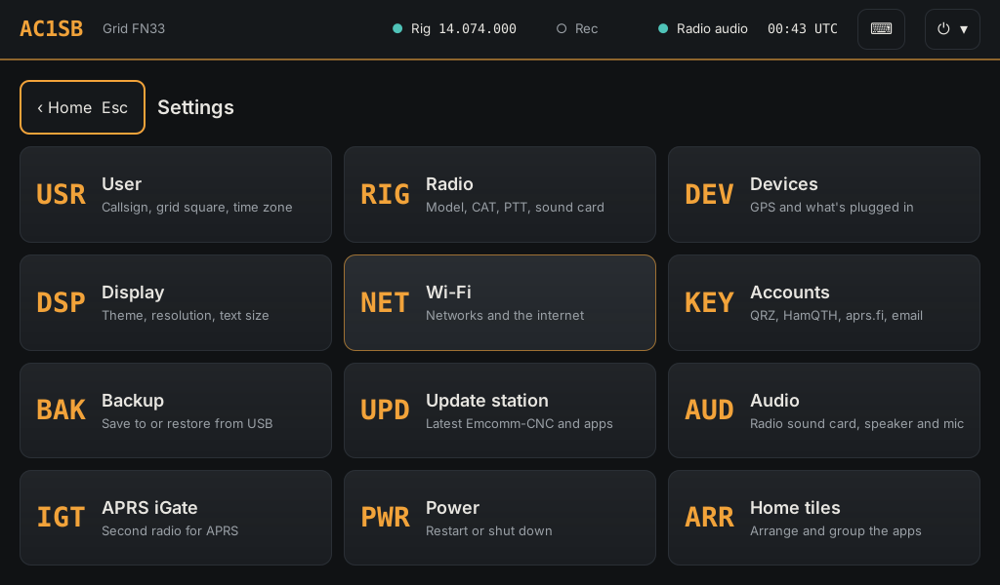

**Settings** (⏻ ▾ > Settings, or F3) is a page of tiles:

| Tile | What's there |
| --- | --- |
| User | Callsign, grid square (**From GPS** fills it in), time zone |
| Radio | Radio profiles; manufacturer and model; baud rate, CAT port, PTT and PTT port; sound card; mode for digital apps; whether Emcomm-CNC sets up the apps; Test CAT and Test PTT. **Save and use this radio** |
| Devices | GPS port, a Meshtastic radio's GPS for position, what's plugged in, **Free the SDR receiver**, **ADS-B receiver** |
| Display | Colours (Amber dark, Light, Slate blue, Night red, Sunlight), resolution, text size, rotation, start-up screen |
| Wi-Fi | Networks (also F6) |
| Accounts | QRZ, HamQTH, aprs.fi key, contact email |
| Backup | Save settings and lists to a USB stick, or restore |
| Update station | Latest Emcomm-CNC and apps (see [Update station](#update-station)) |
| Audio | Radio sound card, Levels, Listening speaker, Playing now |
| APRS iGate | Second radio for APRS |
| Power | Restart or shut down (desktop: exit) |
| Home tiles | Arrange and group the apps |

### Update station

**Settings > Update station** downloads the latest Emcomm-CNC and rebuilds the
station from it, in a window that shows each step. It usually takes a few minutes.

- **Times:** after any step that took more than 5 seconds the window prints
  `took 1m 12s`. While a step is still running it prints `still working on it` every
  30 seconds, and at the end it lists **the slowest steps**, so a slow update shows
  where the time went. The same lines are in Logs > **Station updates**.
- **Waiting for another program:** only one program at a time can install software.
  If Ubuntu's or Debian's own updates (unattended-upgrades, Software Updater) are
  running, the step says `waiting ... for unattended-upgrade to finish` and carries
  on by itself when they're done (up to 10 minutes). On a desktop computer this is
  most common in the first half hour after it's turned on. To avoid it, let the
  computer's own update finish first.
- **Package lists:** the list of available packages is refreshed only when it's over
  12 hours old. Nothing in Update station upgrades installed packages (the
  computer's own updater does that), so this skips nothing it needs. Turning on
  32-bit packages for VARA makes that refresh bigger, which is why it got slower
  after VARA was installed.
- **In the background:** the weekly FCC and DMR ID list downloads (see
  [Offline callsign and DMR ID lookup](#offline-callsign-and-dmr-id-lookup)).
- **Not in the background:** apps from Flathub (Meshtastic Desktop, Meshy) are
  brought up to date in every Update station once they're installed. Their first
  update after a new Flathub runtime can take several minutes; it shows as one of the
  slowest steps.

### Settings > Radio: radio profiles

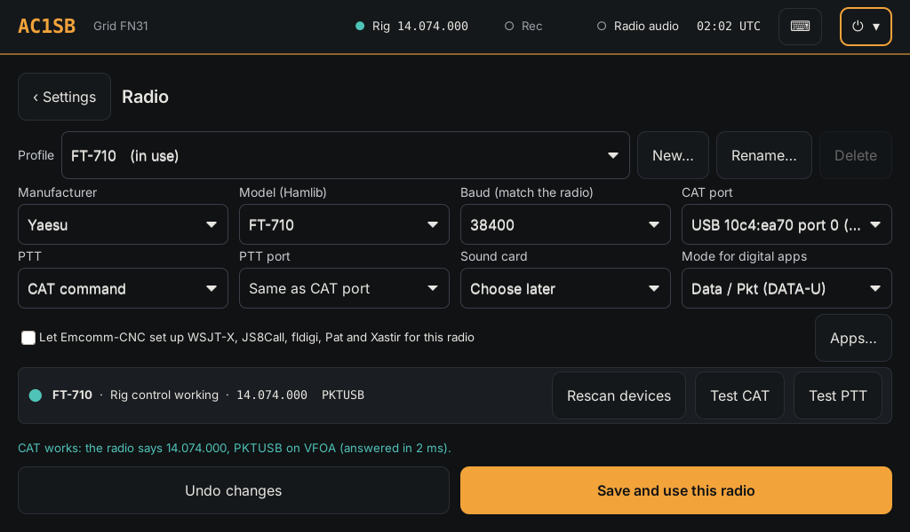

Each radio you use is a **profile**, kept with its own settings. Pick one in
**Profile** and tap **Save and use this radio** to switch the station to it. **New…**
starts a profile from a preset, a copy of another profile, or any other radio Hamlib
supports (picked in the lists); **Rename…** and **Delete** manage them. The profile
in use can't be deleted.

| Field | What to pick |
| --- | --- |
| Manufacturer, Model (Hamlib) | The radio (a preset fills these in) |
| Baud (match the radio) | The same as the radio's CAT rate menu |
| CAT port | The radio's USB serial port, listed by USB ID |
| PTT, PTT port | **CAT command**, or **RTS line** on a Digirig's serial port |
| Sound card | The radio's USB sound card or Digirig |
| Mode for digital apps | **Data / Pkt (DATA-U)** for HF data, **USB**, or **Leave the radio's mode (FM)** for a VHF/UHF FM radio |

The strip under the fields shows whether rig control is working, with the radio's
frequency and mode, and has:

- **Rescan:** looks again for what's plugged in.
- **Find radio:** asks the radio on the CAT port who it is at each baud rate and
  fills in the model and baud. Nothing transmits, but rig control stops for up to a
  minute while it tries, so apps lose the radio meanwhile. Turn the radio on first.
- **Test CAT:** reads the frequency and mode back from the radio.
- **Test PTT:** asks first, then keys the radio for two seconds.

**Swapping radios.** When a radio you've saved as a profile is plugged in and the
one in use isn't, the station asks "*(radio)* is plugged in… Switch to it?". **Switch**
restarts rig control for it (and sets up the apps for it, if that box is ticked);
**Not now** leaves things as they are.

| Radio | Preset | CAT | PTT | Sound card | Mode for digital apps |
| --- | --- | --- | --- | --- | --- |
| Yaesu FT-710 | Yaesu FT-710 | Radio's USB (Enhanced port), 38400 | CAT | Radio's built-in **USB Audio Device** | Data / Pkt |
| Yaesu FT-891 | Yaesu FT-891 + Digirig | Radio's USB (Enhanced port), 38400 | RTS on the Digirig's serial port | Digirig | Data / Pkt |
| Icom ID-5100 | Icom ID-5100 + Digirig | Icom's OPC-2350LU data cable, 19200 | RTS on the Digirig's serial port | Digirig | Leave the radio's mode (FM) |

Set the radio's own CAT rate menu to the same baud rate. One ID-5100 can't be both
the main radio here and the APRS radio in Settings > APRS iGate. ⚠ The ID-5100
preset is not yet tested on the radio.

The radios' own menu settings are in [Part 4](#the-radios-own-menu-settings).

### Two radios at once: Radio 1 and Radio 2

**Radio 1** and **Radio 2** at the top right of Settings > Radio each edit one radio.
Radio 1 is the main radio. Radio 2 is a second radio running alongside it, with its
own rig control (`127.0.0.1:4533`) and sound card, for example the FT-710 on HF and a
VHF/UHF radio for packet or VARA FM. Radio 2 is **Off** until you pick a profile for it
and tap **Save and use this radio**. Each radio has its own light, **Test CAT** and
**Test PTT**. One profile can't be both radios.

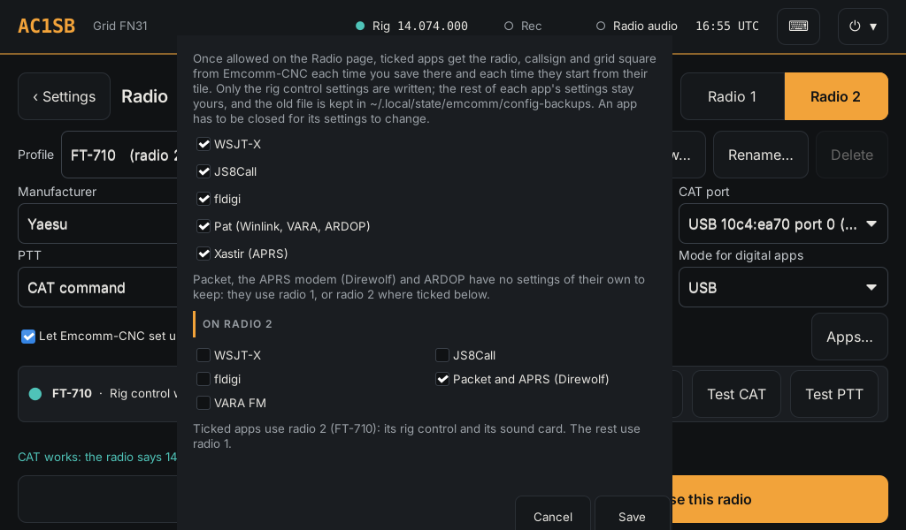

**Apps…** picks which apps use radio 2, under **On radio 2**: WSJT-X, JS8Call,
fldigi, QSSTV, **Packet and APRS (Direwolf)** and **VARA FM**. A ticked app uses radio 2's rig
control and sound card; the rest use radio 1. With the "set up the apps" box ticked,
the station points those apps at radio 2 for you. Without it, set a radio-2 app's rig
control to **127.0.0.1:4533** by hand (the rest of its settings are as in its chapter).

Radio 2 is separate from the APRS radio in Settings > APRS iGate; one radio can't be
both.

---

## Diagnostics

**Diagnostics** (⏻ > Diagnostics, or F2) opens on a report of USB devices, radio
ports, sound cards, services, rig control, GPS and time, and recent USB events. The
list at the top picks one check instead (type to search it):

- **Everything:** the full report (not the mesh radio).
- **USB devices**, **Radio ports and USB serial ports**, **Sound cards**,
  **Services**, **Rig control**, **GPS and time**, **USB plugged and unplugged**.
- **Mesh radio:** asks a USB Meshtastic radio about itself. See below.
- **Warnings and errors since start-up:** the computer's own log, in UTC.

The buttons on the right:

- **Read frequency:** asks the radio for its frequency through rig control.
- **PTT test (2 s):** keys the radio for two seconds.
- **Audio levels:** opens Settings > Audio.
- **Rig control log:** what rigctld is doing, live, in the terminal.
- **Terminal** (or Ctrl+Alt+T from anywhere): a command line. See below.

The same report is available over SSH with `emcomm-diag` (`emcomm-diag mesh` and
`emcomm-diag log` for the two checks that aren't in it).

### Mesh radio check

Plug the Meshtastic radio in by USB, close the **Meshtastic** and **Mesh text** tiles
(a radio takes one connection at a time), and pick **Mesh radio** in the list. It
takes up to a minute and changes nothing on the radio. It shows:

- the radio's name, hardware, firmware, region and role;
- the GPS: **on**, **switched off** or **none fitted**, and how often it checks and
  sends its position;
- whether **Fixed position** is on (a typed-in position, not the GPS);
- the radio's own position, when the GPS last fixed it (UTC) and how many
  satellites it saw;
- **What to do**, when something is wrong: the region not set, the GPS off, no fix
  yet, or a fix over an hour old.

The station never sets its clock from a Meshtastic radio: it reports time in whole
seconds only. For the clock with no internet, use a USB GPS.

Which radio it asks: the one picked for the station's position in Settings >
Devices, else the one Mesh text last used by USB, else the only USB serial port
that isn't the radio's or the GPS's. It never opens the radio's CAT or PTT port or
the USB GPS. With more than one possible port it lists them; use the terminal with
`emcomm-mesh-check --port` and the port's name.

### Terminal

A command line on the station, for checks like the ones above and for when you're
asked to run something. On a station it runs as the station user (`radio`), with no
admin rights; for admin work type `su - ` and your admin username, then `sudo -i`.
In desktop mode it runs as you.

- **Station commands…** lists ready-made commands; type to search. Picking one types
  it in at the prompt without running it, so you can read or change it first. Tap
  **⏎ Run** (or press Enter) to run it. Among them: the mesh radio check, Meshtastic's
  `--info`, `--get position` and `--nodes`, turning the radio's GPS on, which USB
  serial port is which, watching USB plug and unplug, gpsd, the clock, and the rig
  control log.
- The keys under it are the ones the on-screen keyboard lacks or hides: **Esc**,
  **Tab**, **Ctrl+C** (stops a command), the arrows (↑ ↓ bring back earlier
  commands), **|**, **~**, **/** and **-**. Tapping the terminal on a touchscreen
  brings up the on-screen keyboard; ⌨ in the top bar does too.
- **A−** and **A+** change the text size (kept for next time). **Copy** copies what's
  selected (drag across it first); **Paste** pastes. With a keyboard, Ctrl+Shift+C
  and Ctrl+Shift+V.
- **New** closes the shell and starts another. Typing `exit` ends it; coming back to
  the page starts a new one.
- Esc and Ctrl+key presses go to the terminal, not to the launcher. F1 goes Home.

`meshtastic` in the terminal is Meshtastic's own command line, put on the mesh
radio's port for you: `meshtastic --info` works with no `--port`. Without that,
Meshtastic would try every USB serial port, the radio's CAT and PTT ports
included, and opening a PTT port can key the transmitter. Close the Meshtastic and
Mesh text tiles first. `--host` (a node on the network) and `--ble` work as usual.
`meshtastic --set ...` does change the radio's settings.

---

---

# Part 3: ARES and RACES walkthroughs

Whole jobs, start to finish, for an activation. Under RACES, operate only as the
served agency's RACES plan and its radio officer authorise.

## Activation: the first 15 minutes

1. **Start-up check** ([Before you operate](#before-you-operate-the-start-up-check)):
   radio on, Rig and Radio audio green, UTC right, PTT test.
2. **Weather and alerts:** read any alert in the top bar; check **NOAA radio** has
   your counties.
3. **Tune the net:** Reference > **My frequencies** > **Tune** on the ARES net
   frequency.
4. **Start recording:** **Rec** > **Record when there's a signal**, so the whole net
   is kept with UTC times.
5. **Open the net log:** Forms > **New ▾ > Net log** if you're net control, or keep
   **Logs** open to note your own check-in and traffic.
6. **Scanner** on the local public-safety groups, on the listening speaker, if you
   need the picture on the ground.
7. **Winlink ready:** Reference > **Nearest Winlink gateways** > **Update list** while
   there's still internet, and note two or three HF gateways (one on 80 m, one on
   40 m) for NVIS.

## Run a net as net control

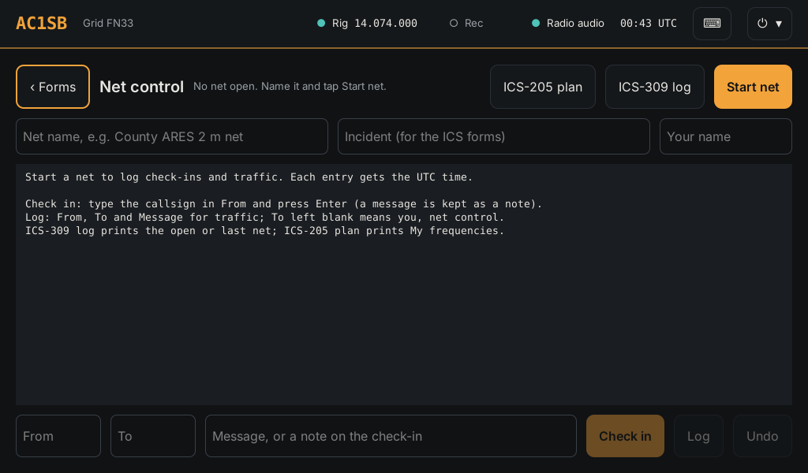

1. Forms > **New ▾ > Net log** (or F8). Type the **net name**, the **incident**
   (it goes on the ICS forms) and **your name**, then tap **Start net**.
2. Take check-ins: type each callsign in **From** and press Enter (or **Check in**).
   As you type, the line above shows the name, town and licence class from the FCC
   licence list kept on the station (no internet needed). An expired licence shows
   in red, and a US call that isn't in the list is flagged, which often means a
   miscopied call: ask for it again. The check-in is logged with that name and town,
   and they print on the ICS-309. A note on the check-in (location, "mobile", "no
   traffic") goes in **Message**.
3. Log traffic: **From**, **To** (blank means you, net control) and **Message**, then
   **Log**. **Undo** removes the last entry.
4. Hand a formal message to an ICS-213: Forms > **New ▾ > ICS-213 message**; the
   incident name is filled in while the net is open.
5. At the end, tap **Close net**, then **ICS-309 log**. It opens the ICS-309 with
   every entry, ready to **Print** or save as a PDF.

**ICS-205 plan** on the same page prints the radio plan from My frequencies (keep
each row's note as its assignment, for example "ARES command net").

## Pass formal traffic: which way to send it

| Situation | Send by | How |
| --- | --- | --- |
| Short message, other station on the same voice net | Voice | Read it in ICS-213 order; log it in Net control |
| ICS-213 to another fldigi/flmsg station on VHF/UHF or HF | fldigi (MT63-2000L) | Forms > pick it > **Send by radio** |
| Message to an agency email address, or out of the area | Winlink | [Send an ICS-213 by Winlink](#send-an-ics-213-by-winlink) |
| Long list or file (shelter roster, spreadsheet) | flamp through fldigi | Open fldigi, then flamp |
| Photo of damage, a map or a filled-in paper form | SSTV (QSSTV) | [SSTV](#sstv-pictures-over-the-air-qsstv) |
| Short text when HF is poor | JS8Call | Directed message to the station's callsign |

Received ICS-213s from fldigi appear on the Forms page by themselves. Pick one and
**More ▾ > Print** to hand a paper copy to the served agency.

## Send an ICS-213 by Winlink

1. Write the ICS-213 in Forms and **Save** it.
2. Start the modem, then Winlink mail ([order](#which-apps-work-together-and-in-what-order)).
3. Start a new message in Pat. **To:** the recipient's email address or Winlink
   callsign. **Subject:** "ICS-213: " and the message's subject.
4. Copy the ICS-213's fields into the body in form order (Incident, To, From,
   Subject, Date, Time, Message, Approved by). Plain text is smallest and fastest
   over HF.
5. If the recipient needs the form itself, attach the PDF: in Forms, **More ▾ >
   Print** and save as PDF (a copy also lands in `~/ICS forms`). A PDF takes much
   longer to send on HF than text; on VARA FM or packet it's fine.
6. **Connect** through the modem as usual.

## Watch public safety and the weather while you operate

All of these use RTL-SDR dongles, not the radio, so they run alongside any radio
app and never transmit:

- **Scanner** on the local groups and a distance that covers your area. Its sound
  goes to the listening speaker, never to the radio.
- **NOAA radio** decodes weather alerts for your counties. It needs its own dongle
  while the Scanner runs; with one dongle, alerts pause until the Scanner closes.
- **Map > Warnings** shows NWS warning areas (fetched while online, kept after).
- **Recorder** keeps the radio's receive audio, with times, for the after-action
  report.

## No internet: what still works

| Works with no internet | Needs the internet |
| --- | --- |
| Every radio app (Winlink by radio, fldigi, JS8Call, WSJT-X, APRS on RF) | Online page (it shows the last saved answers) |
| Forms, Net control, ICS-309 and ICS-205, printing | Map backgrounds Streets, Satellite, Topo (**Map** works) |
| Logs, Recorder, Reference, gateway finder (from the saved list) | Updating the gateway list |
| Scanner, Gqrx, NOAA radio alerts, ADS-B aircraft | Broadcastify, the APRS iGate |
| Map (offline), Library (books already downloaded) | Library downloads, Update station |
| GPS position and time; position from a Meshtastic radio's GPS | Online callsign lookup with QRZ and aprs.fi (earlier lookups still show) |
| Callsign and DMR ID lookup in Net control and Logs (offline FCC and RadioID lists) | Refreshing those lists (Update station, weekly) |

Without a USB GPS or internet, the clock drifts (a Meshtastic radio doesn't set it). Check UTC against WWV (2.5, 5, 10, 15
MHz) before digital work.

## Shift change and end of activation

1. Log the handover in Net control ("NCS handed to …").
2. Hand over: open apps, the open net, any messages not yet sent (Forms list).
3. At the end: **Close net**, **ICS-309 log** > Print or PDF to a USB stick.
4. **Rec > Stop**. Recordings are in `~/Recordings`, named with the UTC time.
5. **Settings > Backup** to a USB stick: settings, lists, nets and forms.
6. Shut down from **⏻ ▾ > Power…**.

## Preparedness: the monthly check

With internet:

1. **Settings > Update station.** It also starts a background download of the
   offline FCC callsign and DMR ID lists when they're over a week old (about 170 MB).
   Read Logs > **Station updates** if anything failed, and Logs > **Callsign list
   downloads** a few minutes later.
2. **Reference > Nearest Winlink gateways > Update list.**
3. **Library:** download any new books; check the ones you rely on open.
4. **Online:** check alerts and propagation load.

On the air:

5. Start-up check, including the PTT test.
6. Send yourself a Winlink message over VARA HF or ARDOP, and check it arrives.
7. Check in to a local net, logged in Logs.
8. Run the Scanner and check NOAA radio heard the weekly test (Online page).

Then:

9. **Settings > Backup** to the go-kit's USB stick.
10. Print this guide (Guide tile > **Print**) if it changed, for the go-kit.

---

# Part 4: Radio settings, troubleshooting and files

## The radios' own menu settings

⚠ **Not yet checked on these radios.** Menu names below are as Yaesu and Icom
describe them; firmware updates move and rename items. Check each against the
radio's manual before relying on it.

### Yaesu FT-710 (one USB cable)

| Setting | Value | Why |
| --- | --- | --- |
| CAT RATE (CAT-1) | 38400 bps | Must match Settings > Radio |
| CAT time-out timer | 100 ms or longer | Avoids missed CAT replies |
| Data mode for digital | **DATA-U** (the station's apps pick it through CAT) | Data/Pkt in WSJT-X and JS8Call |
| Data modulation source | **USB** (the rear USB port, not the mic) | Transmit audio comes from the computer |
| USB audio levels (USB MOD GAIN, USB OUT LEVEL) | Middle of the range to start | Fine-tune with Settings > Audio > Levels |
| VOX | Off | The apps key the radio by CAT |
| Speech processor, DNR/NB on transmit | Off for digital | Distort data signals |

### Yaesu FT-891 with a Digirig

| Setting | Value | Why |
| --- | --- | --- |
| 05-06 CAT RATE | 38400 bps | Must match Settings > Radio |
| DATA MODE | OTHERS | DATA-U behaves as plain USB data |
| DATA IN SELECT | REAR | Audio comes in on the rear DATA jack (the Digirig) |
| DATA PTT SELECT | DAKY | The Digirig keys the radio on the DATA jack |
| DATA OUT LEVEL | About 50 to start | Receive audio to the Digirig |
| VOX | Off | |

Settings > Radio: preset **Yaesu FT-891 + Digirig** (PTT is RTS on the Digirig's
serial port).

### Icom ID-5100 for APRS (Digirig Mobile, ICOM RJ-45 cable)

| Setting | Value |
| --- | --- |
| Mode and frequency | FM, 144.390 MHz (North America), on the band the Digirig uses |
| VOX | Off |
| Squelch | Just closed on band noise |
| Volume | Fairly low; set From radio so packets decode |
| Hand mic | Unplugged while the APRS radio is in use |
| Time-out timer | Long enough for a beacon (any setting over a few seconds) |

## Troubleshooting

| Problem | Check |
| --- | --- |
| Test CAT or Read frequency fails | Radio on and USB plugged in; Settings > Radio > **Rescan**, then **Find radio** to fill in the model and baud; **Save and use this radio** |
| An app says it can't reach the radio | It's set to **Hamlib NET rigctl, 127.0.0.1:4532**, not FLRig or the radio's own model. With the Settings > Radio box ticked, close the app and open it again from its tile |
| Radio doesn't transmit | Diagnostics > PTT test; the app's PTT method is CAT |
| Transmits but no audio goes out | Settings > Audio > Radio sound card names the radio; To radio level isn't at zero; Settings > Audio > Playing now shows the app on the radio |
| Tones come out of the computer's speaker | Is Emcomm-CNC open? With it closed in desktop mode set to Never, pick the radio's **USB Audio Device** in the app. |
| The radio's sound card keeps disappearing and coming back | Diagnostics > recent USB events. Usually RF on the USB cable or a weak USB port: add clip-on ferrites at both ends, plug straight into the computer rather than a hub, and try another port |
| ALC high, signal distorted | Lower **To radio** |
| FT8 or JS8 decodes nothing | Clock (UTC in the top bar); From radio level; radio on the right dial frequency in USB/DATA |
| Pat won't connect | Modem open first; one modem only; see [When it doesn't connect](#when-it-doesnt-connect) |
| Scanner or Gqrx says the receiver is busy | Settings > Devices > **Free the SDR receiver** |
| A tile says **Didn't start** | Try again; if it repeats, Logs > Station updates, then Update station |
| Something stopped working after an update | Logs > **Station updates** shows which step failed |
| Update station is slow | The end of Logs > **Station updates** lists the slowest steps. **Waiting for unattended-upgrade** means the computer's own updates are running: let them finish first. See [Update station](#update-station) |

---

## Where things are kept

| What | Where |
| --- | --- |
| Station settings | `/etc/emcomm/station.json` |
| Your Emcomm-CNC settings | `~/.config/emcomm/` |
| My frequencies | `~/.local/share/emcomm/reference/My frequencies.csv` |
| Scanner list | `~/Scanner channels.csv` |
| Net logs | `~/.local/share/emcomm/nets` |
| ICS-309 and ICS-205 | `~/ICS forms` |
| ICS-213 messages | `~/.nbems/ICS/messages` (written), `~/.nbems/WRAP/recv` (received), `~/.nbems/WRAP/send` (sent) |
| Recordings | `~/Recordings` |
| Winlink attachments opened on the Files page | `~/Winlink attachments` |
| Library books | `~/Library` |
| Pat (Winlink) | `~/.config/pat/config.json` |
| Offline FCC callsign list | `/var/lib/emcomm/callsigns.db` |
| Offline DMR ID list | `/var/lib/emcomm/dmrids.db` |
| Update log | `/var/log/emcomm-update.log` |
| Callsign list download log | `/var/log/emcomm-callsign.log` |

**Settings > Backup** saves your settings, lists and tile arrangement to a USB stick.
